# Carnet

**Un Notion maison, libre, posé sur un simple dossier de fichiers Markdown. Tes agents IA écrivent les fichiers ; la page que tu as ouverte se met à jour sous tes yeux.**

[](LICENSE)


[English](README.md) · **Français**

<p align="center">
  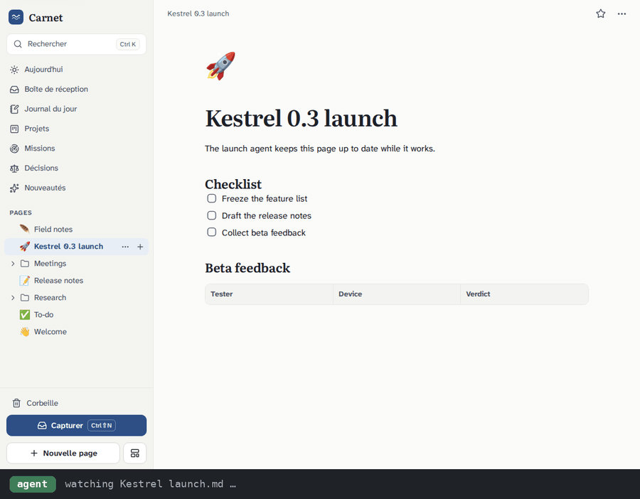
</p>

Carnet est un éditeur de pages en blocs (un arbre de pages, le menu `/`, des tableaux, des cases à cocher, des encadrés, des schémas, des graphiques), agréable sur téléphone, posé sur **un simple dossier de fichiers Markdown**. Pas de base de données, pas de compte, pas de cloud : tes notes restent des fichiers que tu peux lire, versionner et sauvegarder. Tes agents (Claude Code, un script, une tâche planifiée) écrivent ces fichiers, directement ou par une petite API HTTP, et la page ouverte affiche le changement en une fraction de seconde, sans écraser ce que tu es en train de taper.

## Pourquoi

- **Tes agents écrivent déjà en Markdown.** Autant leur donner un endroit où l'écrire proprement, plutôt que de les brancher sur l'API d'un service tiers.
- **Tu veux une vraie interface**, agréable sur téléphone, pas un éditeur de texte brut : un arbre de pages, un menu `/`, des tableaux, des cases à cocher, des encadrés colorés.
- **Tu veux garder la main.** Des fichiers, git, aucun verrou. Si Carnet disparaît demain, tes notes sont toujours là, lisibles partout.
- **Tes agents lisent des contenus non fiables.** Un agent lit des mails et des pages web : un contenu piégé ne doit jamais pouvoir s'exécuter chez toi. Carnet n'exécute jamais le contenu d'une page et isole tout ce qui est du code sur une autre origine.

## Démarrage rapide

Il te faut Docker avec le plugin Compose (v2), et git. Ensuite, une commande :

```bash
git clone https://github.com/MisterBD/carnet.git && cd carnet && ./scripts/installer.sh
```

[`scripts/installer.sh`](scripts/installer.sh) est court : lis-le avant de le lancer. Il vérifie Docker, lance [`scripts/initialiser.sh`](scripts/initialiser.sh) (qui crée `.env`, la clé de signature en `chmod 600` et le dossier d'état, sans jamais rien écraser), vérifie que les deux ports sont libres sur `127.0.0.1`, puis lance `docker compose up -d --build --wait`. La première construction prend quelques minutes.

Ouvre <http://127.0.0.1:3020> : tu arrives dans l'espace de démonstration (`demo/`, un atelier de vélos imaginaire).

- **Autres ports** (au premier lancement seulement, ils sont ensuite écrits dans `.env`) : `CARNET_PORT_HOTE=3030 ART_PORT_HOTE=3036 ./scripts/installer.sh`
- **Tes propres notes** : mets `CARNET_ESPACE_HOTE=/chemin/vers/tes/notes` dans `.env`, puis `docker compose up -d`.
- **Arrêter** : `docker compose down`. **Journaux** (méthode, route, statut, durée, identité ; jamais de contenu) : `docker compose logs -f carnet`.
- **À la main** : `./scripts/initialiser.sh && docker compose up -d --build`. Sans Docker : voir [docs/deploiement.md](docs/deploiement.md#sans-docker).
- **Tu passes de la V2 à la V3 ?** Aucune migration de pages : voir [Mettre à jour depuis la V2](docs/deploiement.md#mettre-à-jour-depuis-la-v2).

L'essai local tourne en mode développement (`CARNET_DEV=1`), **sans authentification, sur `127.0.0.1` seulement**. Lis le [modèle d'exposition](#sécurité-et-modèle-dexposition) avant de l'ouvrir à tes autres appareils.

## Faire écrire tes agents

Deux façons d'écrire ; la page ouverte se met à jour en direct dans les deux cas.

**1. Écrire le fichier** (le cas courant). Carnet surveille le dossier. Écris de façon atomique, avec un fichier temporaire caché dans le même dossier puis un renommage, pour que Carnet ne lise jamais un fichier à moitié écrit :

```bash
tmp="Projets/.Bilan du trimestre.md.tmp"
cat > "$tmp" <<'FIN'
---
title: Bilan du trimestre
icon: 📈
statut: à relire
tags: [rapport]
resume: "412 vélos réparés (+8 %), trois bénévoles font la moitié du travail."
---
# Bilan du trimestre

> [!WARNING] À vérifier
> Le chiffre de septembre n'a pas été confirmé.

- [ ] Confirmer septembre @camille 📅 2026-11-20
FIN
mv -f "$tmp" "Projets/Bilan du trimestre.md"
```

**2. Passer par l'API HTTP**, depuis une autre machine ou quand tu veux la détection des conflits. Toute mutation exige l'en-tête `X-Carnet: 1` (protection CSRF). Le chemin de la page va dans l'adresse. Une création envoie `If-None-Match: *` ; une modification renvoie l'`ETag` qu'elle a lu, et si la page a changé entre-temps le serveur répond `412` avec le contenu actuel au lieu d'écraser :

```bash
# créer une page
curl -sS -X PUT "http://127.0.0.1:3020/api/page?chemin=Notes/Bonjour.md" \
  -H "X-Carnet: 1" -H "If-None-Match: *" -H "Content-Type: application/json" \
  -d '{"contenu": "# Bonjour\n\nÉcrit par un agent.\n"}'
# → {"etag":"\"9c1f…\"","mtime":…}

# la modifier, avec l'ETag reçu
curl -sS -X PUT "http://127.0.0.1:3020/api/page?chemin=Notes/Bonjour.md" \
  -H "X-Carnet: 1" -H 'If-Match: "9c1f…"' -H "Content-Type: application/json" \
  -d '{"contenu": "# Bonjour\n\n- [x] Coché par un agent\n"}'
```

Hors du mode d'essai local, les appels à l'API passent par ton proxy authentifiant, comme n'importe quelle requête. La liste complète des routes est dans [docs/architecture.md](docs/architecture.md#api).

**Ce qu'il faut dire à ton agent** : donne-lui [docs/format-agents.md](docs/format-agents.md) (ou sa version courte dans l'espace de démonstration, `demo/Écrire pour Carnet.md`), ou colle sa section « À coller dans le AGENTS.md » dans ton `AGENTS.md` ou ton `CLAUDE.md`. En résumé : une page Markdown avec un frontmatter court, le niveau le plus bas qui suffit (texte, tableau, encadré, schéma Mermaid, graphique Vega-Lite, et un artefact HTML en dernier recours), une écriture atomique, et jamais de contenu extérieur recopié en HTML brut. Le même guide décrit les tâches datées, les captures, les bases, les modèles, les missions, les demandes de décision, le dossier de rendez-vous, et la façon de vérifier une décision avant d'agir.

## Ce que ça fait

**L'éditeur**
- **Éditeur en blocs** (Tiptap 3, sans paquet payant). Le menu `/` en français : sous-page, lien vers une page, texte, titres, listes, tâche, citation, bloc repliable, séparateur, cinq encadrés, tableau, image, code, schéma, graphique, artefact, date du jour, sommaire. La poignée à gauche d'un bloc ouvre le **menu de bloc** : transformer en, couleur du texte et du fond, dupliquer, monter, descendre, supprimer, ou glisser le bloc ailleurs. Raccourcis à la Notion (`#`, `-`, `[]`, `>`, `+++`, ⌘D, ⌘⇧↑…), coloration du code (25 langages), liens `[[…]]` (et `[[Page#Titre]]`, qui mène au titre), enregistrement automatique.
- **Tes fichiers restent propres.** Une page ouverte sans modification n'est jamais réécrite ; quand tu modifies un bloc, seul ce bloc change dans le fichier. Les couleurs, le surlignage et le bloc repliable ont une écriture Markdown lisible ailleurs (`<span color="red">`, `==surligné==`, `<details>`).
- **Mise à jour en direct.** Un agent écrit, la page ouverte se met à jour en un peu plus d'un dixième de seconde sur la même machine. Si vous écrivez en même temps, rien n'est écrasé : un bandeau te laisse comparer, puis garder ta version, la sienne ou les deux (copie de conflit). Ce que tu tapes reste gardé dans le navigateur jusqu'à ce que le serveur confirme l'enregistrement, même après une coupure réseau ou un rechargement.
- **Schémas et graphiques déclaratifs** : des blocs ` ```mermaid ` et ` ```vega-lite ` rendus dans un cadre isolé. **Artefacts HTML** : un agent livre un tableau de bord ou un simulateur, Carnet l'affiche dans une carte avec aperçu vivant et plein écran, sans qu'il puisse toucher à tes pages ni sortir sur Internet.

**Ranger**
- **Un arbre que tu ranges** : ordre manuel par glisser-déposer (rangé à part, dans `.carnet/ordre.json`, jamais dans tes pages), déplacer, dupliquer, icône et couverture de page, et sous le titre la liste des pages qui pointent vers celle-ci.
- **Aujourd'hui** : les tâches en retard, du jour et des 7 prochains jours de toutes les pages (format Obsidian Tasks, `📅 2026-10-12 ⏫`, cochables d'ici), les décisions à prendre, les missions des agents, les nouveautés, les pages à relire et les pages récentes. Une **Boîte** capture un texte ou un lien en un geste (＋ ou ⌘⇧N) ; le lien est enregistré, jamais téléchargé par le serveur.
- **Bases** : un bloc ` ```base ` affiche un tableau vivant de pages filtrées et triées, aux cellules modifiables, au format d'Obsidian Bases (sous-ensemble, vue tableau). Ce qui n'est pas pris en charge donne une erreur visible, jamais un tableau faux. Les vues se créent, se renomment et s'enregistrent depuis le menu de la base, sans écrire de YAML.
- **Projets** : tableau et kanban construits sur le frontmatter (`statut`, `echeance`, `responsable`, `priorite`). Changer un statut, ou glisser une carte, réécrit **une seule ligne** du fichier.
- **Recherche** (⌘K) dans les titres et les contenus, sans se soucier des accents, avec les pages récentes, un aperçu, et « Créer la page » quand rien ne correspond. Renommer ou déplacer une page met à jour les liens des autres pages.
- **Corbeille** avec « Annuler » pendant 8 secondes et 30 jours de conservation (réglable). **Historique des versions** : tes instantanés, une version automatique après chaque pause de travail, et les versions git si ton dossier est un dépôt git (lu en lecture seule). Comparaison mot à mot, restauration en un geste.
- **Nouveautés** : les pages modifiées hors de Carnet depuis ta dernière lecture, avec la différence exacte. « Revenir à la version marquée vue » annule d'un geste ce qu'un agent a changé (la version retirée reste dans l'historique).
- **Pages** : modèles (dossier `Modèles/`, variables `{{date}}`, `{{heure}}`, `{{titre}}`), journal du jour (`Journal/AAAA-MM-JJ.md`), verrou (`verrou: true`), archive (`archive: true`), bouton **Copier** sur les citations, les encadrés et les blocs de code.

**Pour les agents**
- **Missions** (`type: mission`) : chaque agent tient une fiche (état, dernier signal, prochain pas, livrables). Carnet les classe (à arbitrer, résultats disponibles, en cours) et vérifie que le livrable annoncé existe.
- **Décisions** (`type: decision`) : l'agent écrit une proposition ; tu approuves, demandes une correction ou refuses. Carnet fige la proposition, en garde l'empreinte et signe une attestation hors de ton dossier de pages, qu'un outil vérifie avant d'agir. Avec une clé d'accès (Face ID, Touch ID), l'attestation prouve un geste fait sur ton appareil.
- **Dossier de rendez-vous** : sur une fiche qui liste ses `sources`, « Préparer » rassemble décisions, tâches ouvertes, livrables et notes récentes, sans IA ni réseau, chaque extrait renvoyant à sa source.

**Au quotidien**
- **Pensé pour le téléphone d'abord** : tiroir d'arbre, barre au-dessus du clavier, cibles tactiles de 44 px, thèmes clair et sombre automatiques, installable sur l'écran d'accueil, écran clair quand la connexion manque (jamais de page blanche, jamais une note périmée). Sur iPhone, une barre d'onglets : Aujourd'hui, Rechercher, ＋, Boîte, Pages. Impression et PDF soignés.
- **Léger et rapide** : un serveur Node sans base de données, avec une seule dépendance d'exécution (`yaml`). Mesuré sur la V2 : le conteneur occupe environ 30 Mo de mémoire au repos ; une page s'ouvre en 75 ms depuis l'application et en 120 ms en rechargeant ([mesures détaillées](docs/architecture.md#performances)).

<p align="center">
  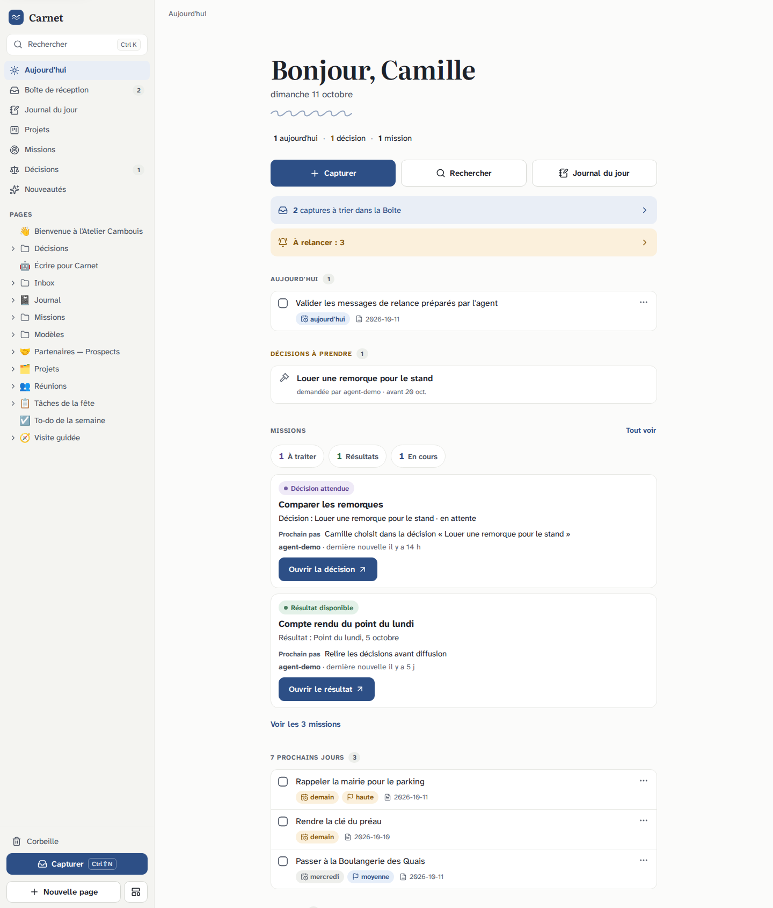
</p>

<p align="center">
  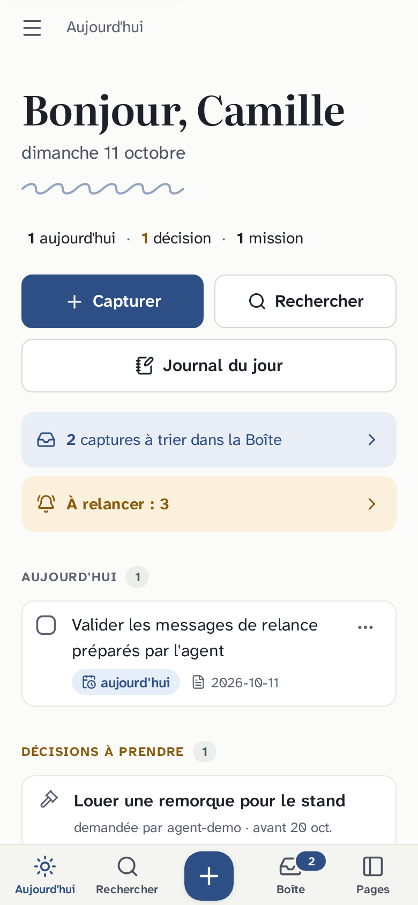
  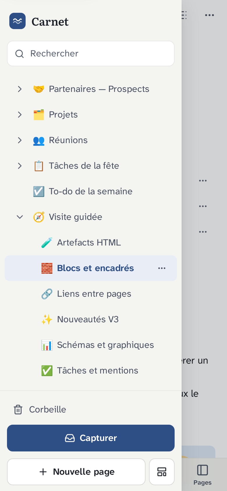
  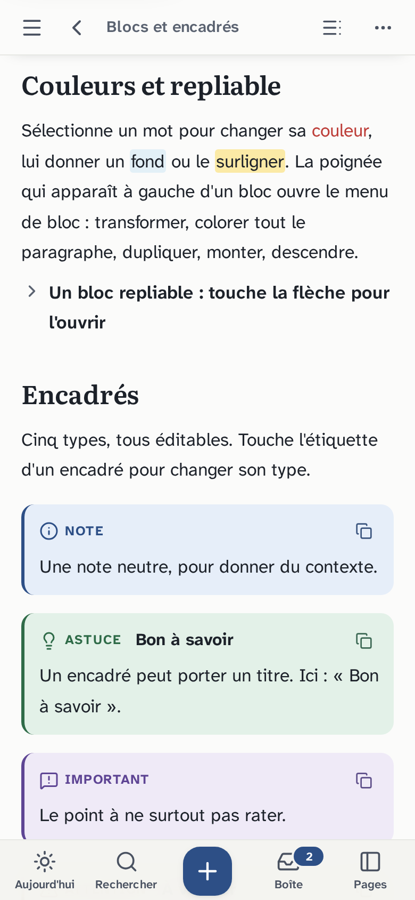
</p>

| Schémas et graphiques | Projets en kanban |
|---|---|
| <a href="docs/img/schemas-bureau.png">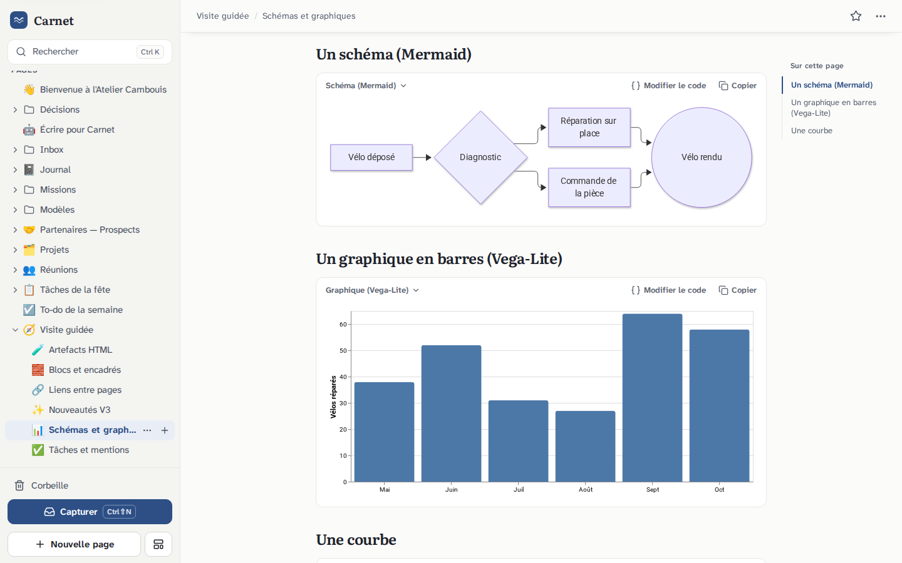</a> | <a href="docs/img/projets-kanban-bureau.png">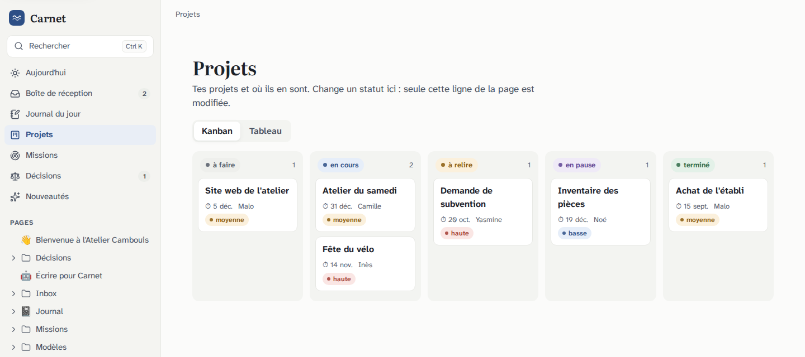</a> |
| **Le menu `/`** | **Le menu de bloc, la couverture et l'icône** |
| <a href="docs/img/menu-slash-bureau.png">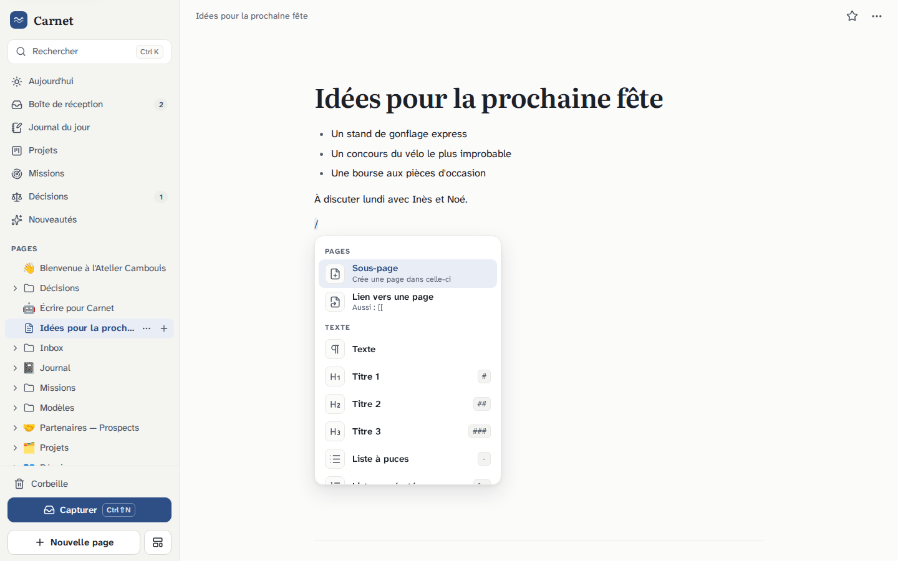</a> | <a href="docs/img/menu-bloc-bureau.png">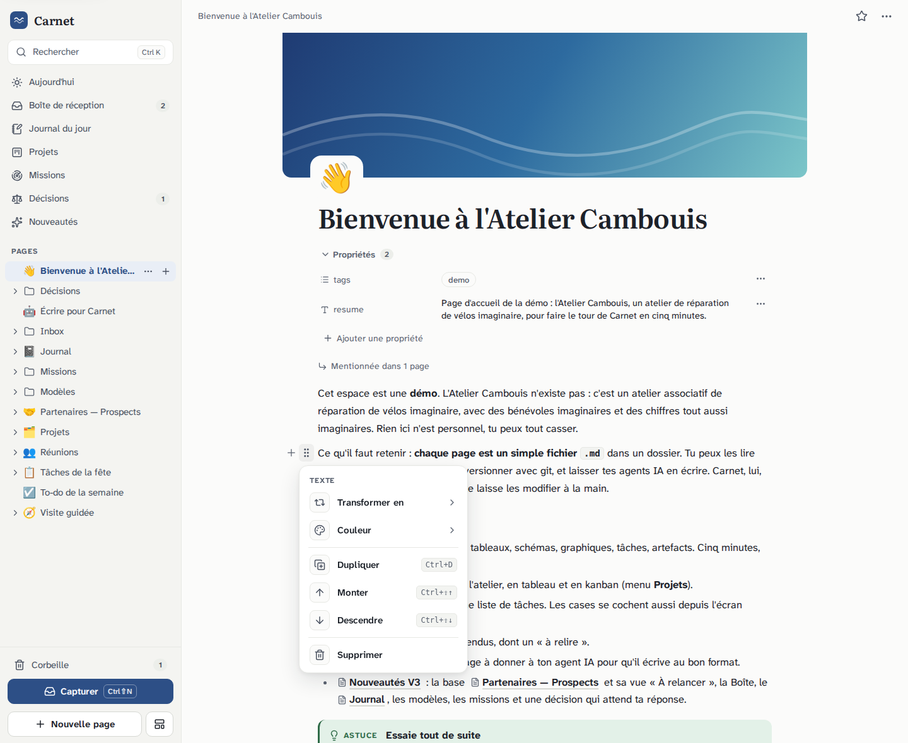</a> |
| **L'historique des versions** | **La corbeille** |
| <a href="docs/img/historique-bureau.png">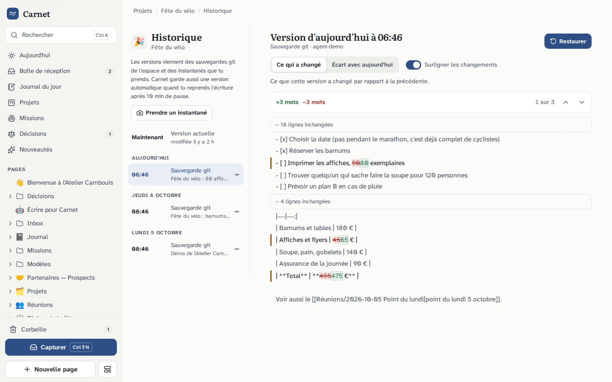</a> | <a href="docs/img/corbeille-bureau.png">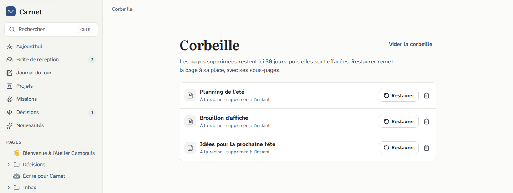</a> |
| **Un artefact HTML dans une page** | **Encadrés et tableau** |
| <a href="docs/img/artefact-bureau.png">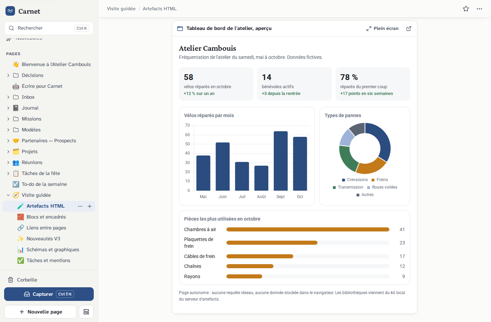</a> | <a href="docs/img/page-blocs-bureau.png">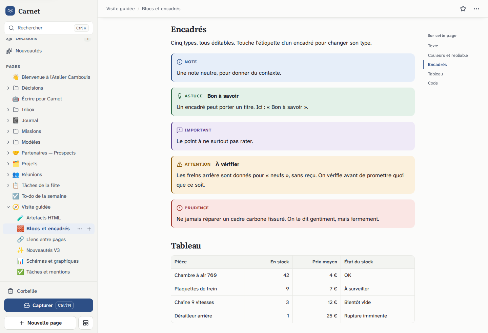</a> |
| **La Boîte** | **Une base et sa vue « À relancer »** |
| <a href="docs/img/boite-bureau.png">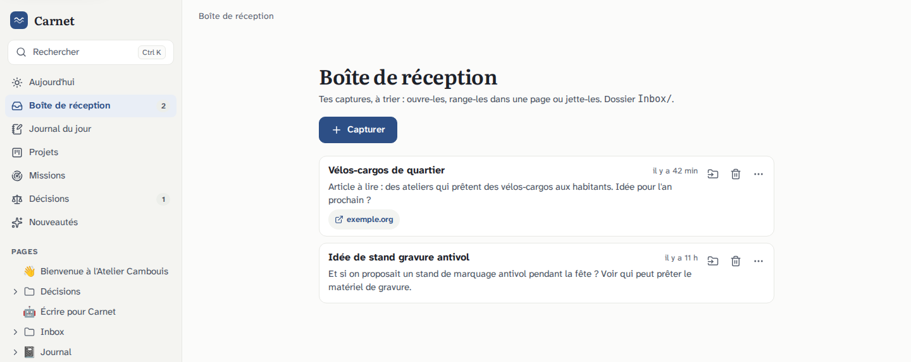</a> | <a href="docs/img/base-relancer-bureau.png">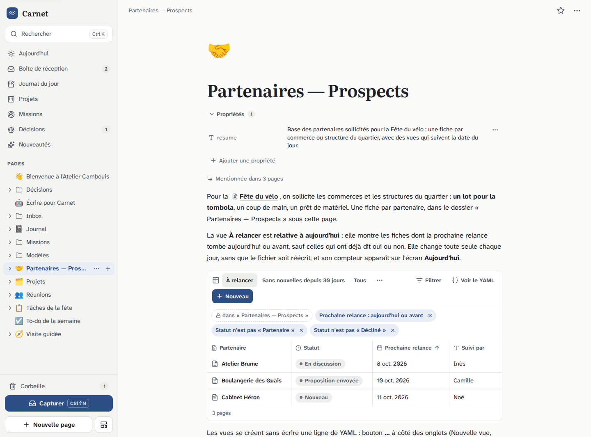</a> |
| **Les missions des agents** | **Une demande de décision** |
| <a href="docs/img/missions-bureau.png">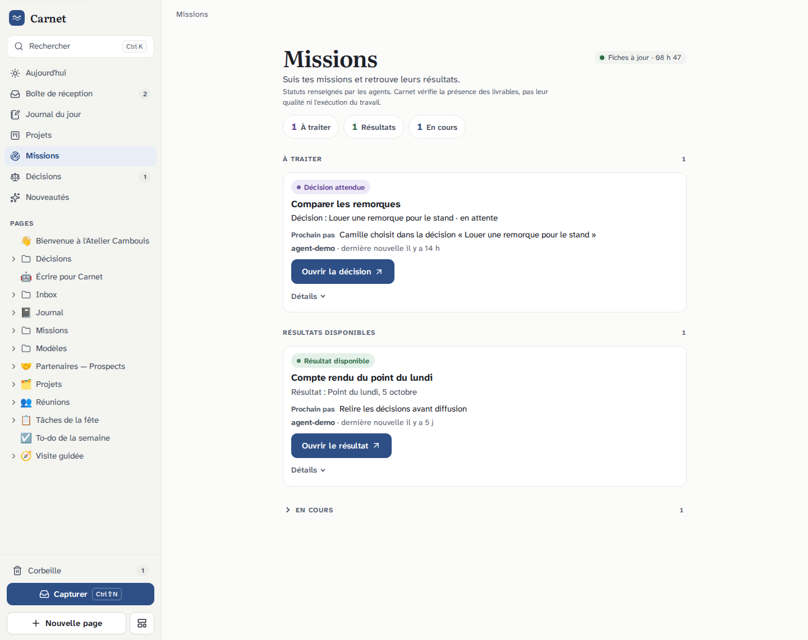</a> | <a href="docs/img/decision-bureau.png">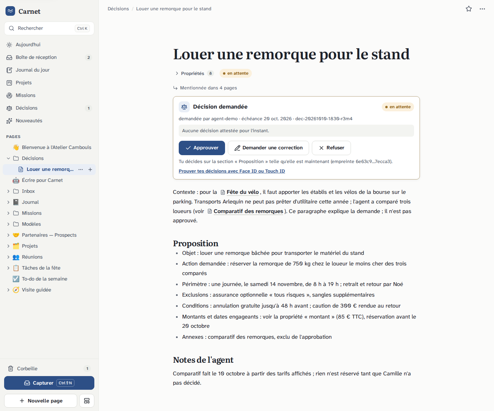</a> |

## Sécurité et modèle d'exposition

Carnet affiche des pages écrites par des agents qui lisent des contenus non fiables : tout part de la façon dont il est exposé.

```
Navigateur ── proxy authentifiant ──┬─▶ carnet     (Node 22)  127.0.0.1:3020   pages .md, API, interface, flux SSE
              (HTTPS, à ton choix)  │
                                    └─▶ artefacts  (Python)   127.0.0.1:3006   artefacts HTML, schémas, sur une AUTRE origine
```

- **Pas de mot de passe, pas d'écran de connexion.** L'identité vient d'un proxy authentifiant qui pose un en-tête HTTP (`CARNET_ENTETE_IDENTITE`), comparé à une liste de comptes autorisés (`CARNET_UTILISATEURS_AUTORISES`). Le proxy doit effacer tout en-tête d'identité envoyé par le client. Trois exemples de configuration sont dans [docs/deploiement.md](docs/deploiement.md#trois-façons-de-louvrir-à-tes-appareils). **Ne l'expose jamais sans authentification.**
- **Les deux ports ne sont publiés que sur `127.0.0.1`**, et chaque service a son propre réseau Docker : un conteneur voisin pourrait forger l'en-tête d'identité.
- **Le mode d'essai reste local.** `CARNET_DEV=1` accepte les requêtes sans identité, et le serveur refuse de démarrer dans ce mode dès qu'une origine non locale est déclarée.
- **Rien d'exécutable sur l'origine de l'application** : le HTML brut d'une page est affiché comme du texte (seules quelques balises de mise en forme, en liste fermée, sont reconnues), et l'application ne sert aucun `.html`, `.svg`, `.js` ou `.css` de tes pages.
- **Les artefacts sont sur une autre origine**, dans un cadre `sandbox` à origine opaque, sans réseau (`connect-src 'none'`), ouverts par un lien signé de 15 minutes. Le serveur d'artefacts ne voit que le dossier `artefacts/`, en lecture seule. Les deux services ne se parlent pas.
- **Une décision écrite dans un fichier ne prouve rien** : Carnet signe une attestation hors de ton dossier de pages pour chaque décision prise dans son interface ; avec une clé d'accès (WebAuthn), elle prouve un geste fait sur ton appareil. Une attestation n'autorise jamais à elle seule une action : l'outil qui agit la vérifie au moment d'agir.
- **Durcissement** : CSP stricte, anti-CSRF (`X-Carnet: 1`, `Origin` et `Sec-Fetch-Site` de même origine), chemins confinés, historique git lu sans shell et en lecture seule, conteneurs en lecture seule sans privilèges, plafonds de mémoire et de processeur, aucune ressource externe, dépendances et images épinglées par empreinte.

Le modèle de menace complet, avec ses limites connues, est dans [SECURITY.md](SECURITY.md). Une faille ? Signale-la en privé (onglet *Security* du dépôt), jamais dans une issue publique.

## Architecture

Deux petits conteneurs durcis : `carnet` (Node 22 : pages, API, interface, flux SSE) et `artefacts` (bibliothèque standard de Python : artefacts HTML isolés, schémas, un kit local de bibliothèques épinglées). **La vérité, ce sont tes fichiers `.md`.** Carnet signe de courts liens HMAC qui ouvrent les artefacts sur l'autre origine. Le détail est dans [docs/architecture.md](docs/architecture.md).

## Limites honnêtes

- **Pas encore essayé sur un vrai iPhone.** L'interface est testée en WebKit (le moteur de Safari) sous Linux et en Chromium, en 390×844 tactile émulé ; le clavier, le sélecteur de date natif, l'encoche et Face ID restent à vérifier sur un appareil.
- **Bases : un sous-ensemble d'Obsidian Bases écrit d'après sa documentation, jamais vérifié dans Obsidian lui-même**, en particulier le tri (`sort`) et la clé `carnet:`, qu'Obsidian pourrait signaler ou retirer en réenregistrant la base. Vue tableau seulement : ni cartes, ni kanban, ni calendrier, ni formules, ni regroupements. Évaluation sans index, confortable jusqu'à quelques milliers de pages.
- **Clés d'accès (WebAuthn) testées avec un authentificateur virtuel seulement** (Chromium, et un authentificateur logiciel côté serveur), jamais avec Face ID ou Touch ID réels. Une clé est liée au nom d'hôte : enregistrée pour une adresse, elle ne vaut pas pour une autre.
- **Attestations** : elles sont signées par une clé du serveur. Un programme qui tourne sous le même utilisateur système que Carnet peut lire cette clé et signer à sa place, et l'effacement de la toute dernière ligne du journal n'est pas détecté (une coupure au milieu l'est). C'est une protection contre l'erreur et l'agent naïf, pas contre un programme malveillant sur la même machine.
- **Déclarations** : l'auteur déclaré d'une modification (`maj_par`), l'état d'une mission ou le `statut` écrit d'une décision ne prouvent rien. Carnet vérifie qu'un livrable existe, pas sa qualité.
- **Brouillons** : ils vivent dans le navigateur où tu as tapé, pas sur tes autres appareils. Au-delà de ces brouillons, pas d'écriture hors ligne.
- **Récurrences** (🔁) affichées et conservées, jamais exécutées ; pas de rappels ni de notifications. **Verrou** : un drapeau dans le fichier, contre les fausses manipulations dans Carnet ; pas un contrôle d'accès.

## Feuille de route

La recette de bout en bout (`tests/recette.py`, 28 étapes, qui vérifient aussi les fichiers sur le disque) tourne en Chromium et en WebKit (le moteur de Safari), sur iPhone émulé et sur ordinateur, en clair et en sombre. Ce qui manque encore, et qu'on aimerait ajouter (rien n'est promis, les contributions sont bienvenues) :

- **Tests publiés** : la suite d'isolation du serveur d'artefacts (requêtes HTTP piégées, navigateurs) et les recettes de l'éditeur et de la navigation, à rendre indépendantes d'une installation particulière.
- **Éditeur** : colonnes, taille et alignement des images, réduction des photos avant l'envoi, menu `@` (pages et dates), pièces jointes, sélection de plusieurs blocs, recherche dans la page.
- **Bases** : vues kanban, calendrier et galerie, relations, formules, regroupements.
- **Tâches** : récurrences exécutées, rappels, flux `.ics` des échéances.
- **Hors ligne** : écrire sans connexion au-delà des brouillons gardés par le navigateur.
- **Import** depuis un export Notion : pages, bases et rapport de ce qui ne passe pas.
- **Navigation** : barre latérale redimensionnable, défilement de l'arbre pendant un glisser.
- **Sécurité** : un secret partagé entre le proxy et Carnet, en plus de l'en-tête d'identité ; la clé et le journal des attestations sous un autre utilisateur système que celui des agents.
- **iPhone réel** : le clavier, l'appui long, l'export PDF, les clés d'accès et la barre d'onglets sont testés en émulation ; les retours sur appareil sont précieux.
- **Interface en anglais**.

Hors périmètre, volontairement : la collaboration en temps réel, une base de données, la gestion des mots de passe, l'exécution de code dans les pages.

## Contribuer, licence

Les contributions sont les bienvenues : [CONTRIBUTING.md](CONTRIBUTING.md) explique comment lancer les tests, ce qu'on attend d'une pull request, et la règle de licence (jamais de code GPL, AGPL, BSL ou propriétaire). Chaque pull request passe une revue de sécurité avant d'être fusionnée. Pour commencer, regarde les issues marquées [good first issue](https://github.com/MisterBD/carnet/labels/good%20first%20issue). Les licences des dépendances, des polices et des icônes sont dans [THIRD_PARTY_NOTICES.md](THIRD_PARTY_NOTICES.md).

**Statut** : projet personnel, partagé tel quel, sans garantie ni support (voir la [licence](LICENSE)). Les issues et pull requests sont lues quand le temps le permet.

Carnet est publié sous [licence MIT](LICENSE). Copyright (c) 2026 Dimitri Foucault.
