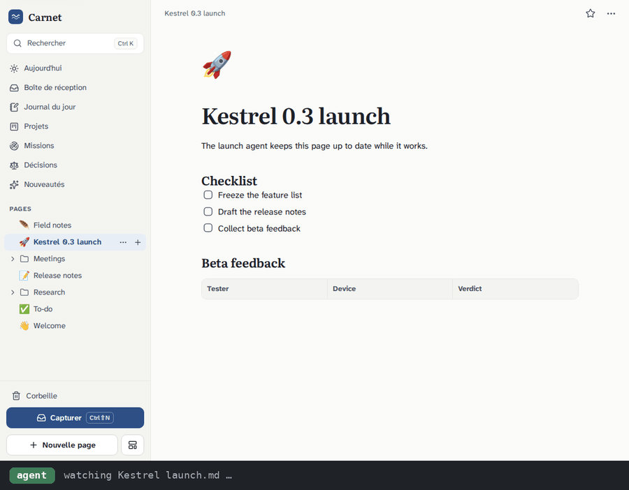
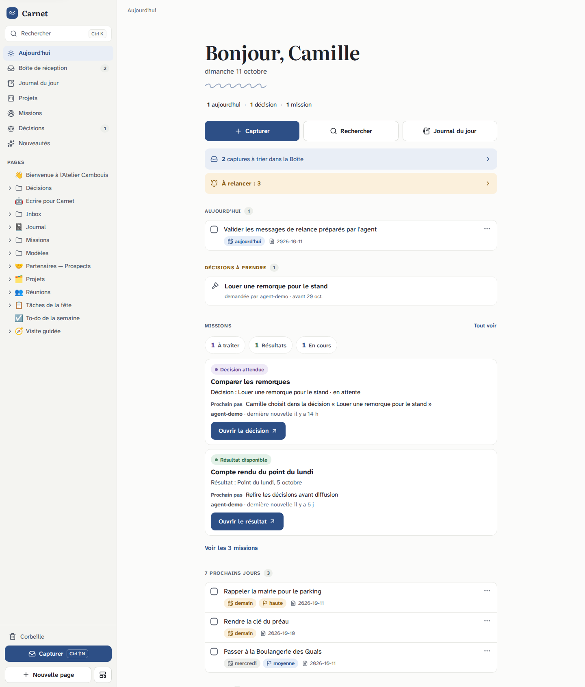
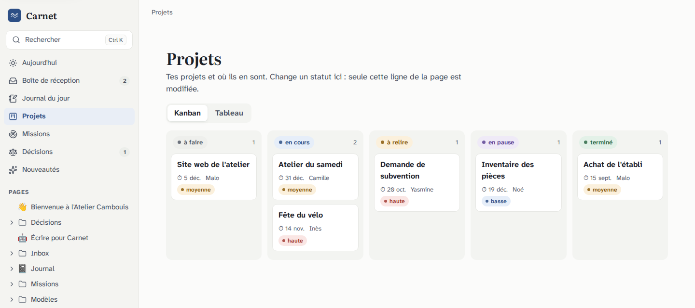
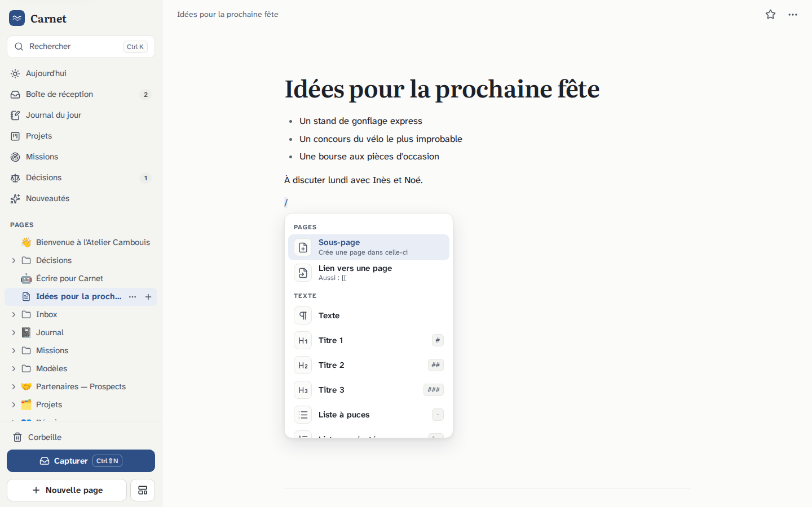
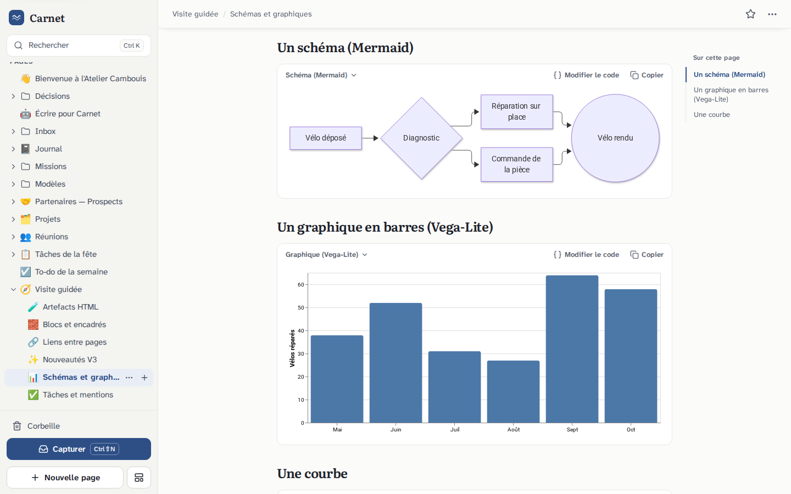
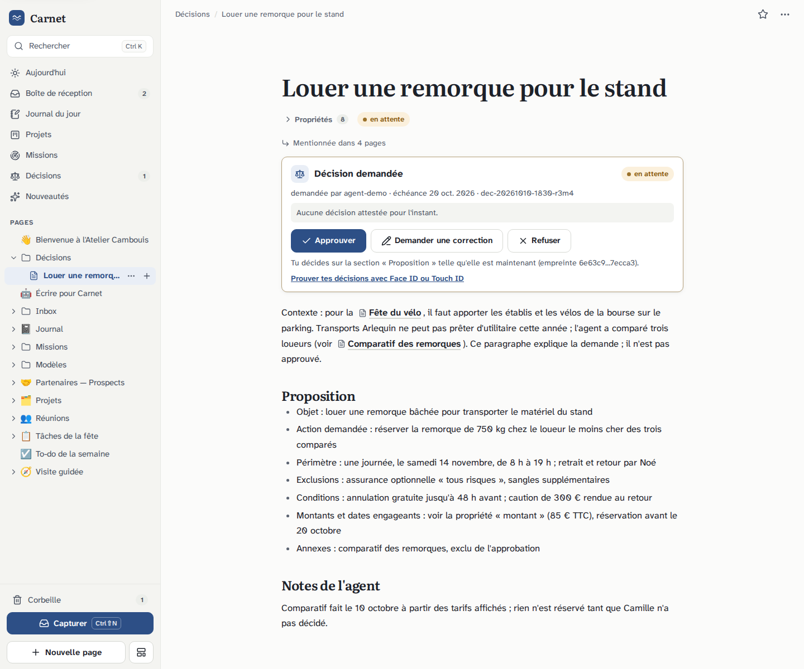
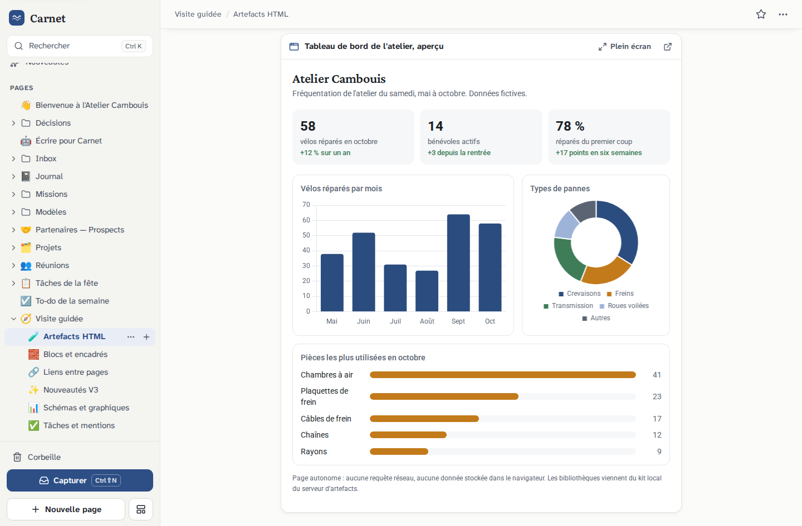
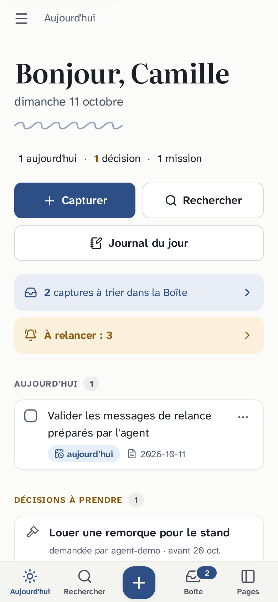
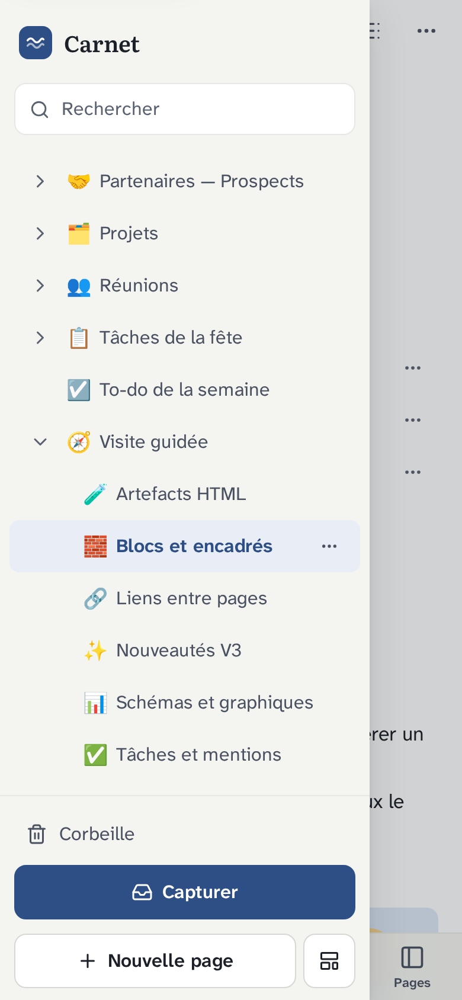
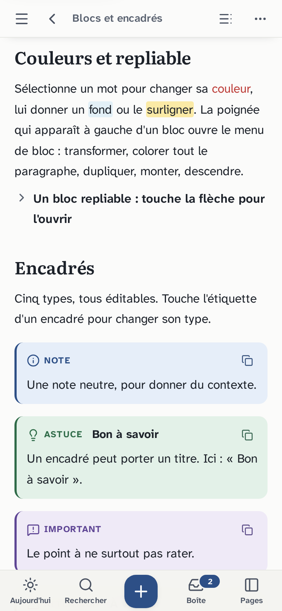

# Carnet

**A self-hosted, block-based notes app on a plain folder of Markdown files. Your AI agents write the files; the page you have open updates live.**

[](LICENSE)


**English** · [Français](README.fr.md)

<p align="center">
  
</p>

Carnet feels like a simple Notion: a page tree, a `/` menu, tables, checkboxes, callouts, diagrams and charts, and it is comfortable on a phone. Underneath there is **no database and no account system, just a folder of `.md` files**. You can read them, grep them, version them with git and back them up. Your agents (Claude Code, a script, a cron job) write those files, directly or through a small HTTP API, and the page you have open shows the change in a fraction of a second, without overwriting what you are typing.

> [!NOTE]
> **The interface is in French** (menus, buttons, screens), and so are the detailed docs in `docs/`. The files are plain Markdown, and this README covers what you need to try it. Issues and pull requests in English are welcome, and so are translations.

## Why

- **Your agents already write Markdown.** Give them a place where it reads well, instead of wiring them to a third-party API.
- **You want a real interface**, pleasant on a phone, not a raw text editor: a page tree, a `/` menu, tables, checkboxes, colored callouts.
- **You stay in control.** Files and git, no lock-in. If Carnet disappears tomorrow, your notes are still readable everywhere.
- **Agents read untrusted content.** An agent that reads emails and web pages must never be able to make injected code run on your device. Carnet never executes page content and isolates everything that is code on a separate origin.

## Quick start

You need Docker with the Compose v2 plugin, and git. Then, one command:

```bash
git clone https://github.com/MisterBD/carnet.git && cd carnet && ./scripts/installer.sh
```

[`scripts/installer.sh`](scripts/installer.sh) is short, so read it first. It checks Docker, runs [`scripts/initialiser.sh`](scripts/initialiser.sh) (creates `.env`, a signing key with `chmod 600` and a state folder, and never overwrites anything), checks that the two ports are free on `127.0.0.1`, then runs `docker compose up -d --build --wait`. The first build takes a few minutes.

Open <http://127.0.0.1:3020>. You land in the demo space (`demo/`, an imaginary bike repair workshop, in French).

- **Other ports** (first run only, they are then written to `.env`): `CARNET_PORT_HOTE=3030 ART_PORT_HOTE=3036 ./scripts/installer.sh`
- **Your own notes**: set `CARNET_ESPACE_HOTE=/path/to/your/notes` in `.env`, then `docker compose up -d`.
- **Stop**: `docker compose down`. **Logs** (method, route, status, duration, identity, never content): `docker compose logs -f carnet`.
- **Manual steps**: `./scripts/initialiser.sh && docker compose up -d --build`. Without Docker: see [docs/deploiement.md](docs/deploiement.md#sans-docker).
- **Upgrading from V2**: no page migration, see [docs/deploiement.md](docs/deploiement.md#mettre-à-jour-depuis-la-v2).

The local trial runs in development mode (`CARNET_DEV=1`): **no authentication, bound to `127.0.0.1` only**. Read the [security model](#security-model) before opening it to your other devices.

## Let your agents write

There are two ways to write, and the open page updates live with both.

**1. Write the file** (the usual way). Carnet watches the folder. Write atomically, with a hidden temporary file in the same folder and then a rename, so that Carnet never reads a half-written file:

```bash
tmp="Projects/.Launch checklist.md.tmp"
cat > "$tmp" <<'EOF'
---
title: Launch checklist
icon: 🚀
tags: [launch]
---
# Launch checklist

> [!WARNING] To check
> The benchmark numbers are from last week.

- [x] Draft the release notes
- [ ] Record the demo @camille 📅 2026-11-20
EOF
mv -f "$tmp" "Projects/Launch checklist.md"
```

**2. Use the HTTP API**, from another machine or when you want conflict detection. Every mutation needs the `X-Carnet: 1` header (CSRF protection). The page path goes in the URL. A creation sends `If-None-Match: *`; an update sends back the `ETag` it read, and if the page changed in the meantime the server answers `412` with the current content instead of overwriting it:

```bash
# create a page
curl -sS -X PUT "http://127.0.0.1:3020/api/page?chemin=Notes/Hello.md" \
  -H "X-Carnet: 1" -H "If-None-Match: *" -H "Content-Type: application/json" \
  -d '{"contenu": "# Hello\n\nWritten by an agent.\n"}'
# → {"etag":"\"9c1f…\"","mtime":…}

# update it, with the ETag you got
curl -sS -X PUT "http://127.0.0.1:3020/api/page?chemin=Notes/Hello.md" \
  -H "X-Carnet: 1" -H 'If-Match: "9c1f…"' -H "Content-Type: application/json" \
  -d '{"contenu": "# Hello\n\n- [x] Checked by an agent\n"}'
```

Outside the local trial mode, API calls go through your authenticating proxy like any other request. The full route list is in [docs/architecture.md](docs/architecture.md#api).

**What to tell your agent**: give it [docs/format-agents.md](docs/format-agents.md) (or the short version in the demo space, `demo/Écrire pour Carnet.md`), or paste its section « À coller dans le AGENTS.md » into your `AGENTS.md` or `CLAUDE.md`. In short: Markdown with a short frontmatter, the lowest level that does the job (text, table, callout, Mermaid diagram, Vega-Lite chart, and an HTML artifact only as a last resort), atomic writes, and never external content pasted as raw HTML. The same guide covers dated tasks, captures, bases, templates, missions, decision requests and meeting briefs.

## What it does

**Editor**
- **Block editor** built on Tiptap 3 (no paid packages). The `/` menu: sub-page, link to a page, text, headings, lists, task, quote, toggle, divider, five callouts, table, image, code, diagram, chart, artifact, today's date, table of contents. The handle on the left of a block opens the **block menu**: turn into, text and background color, duplicate, move up or down, delete, or drag the block elsewhere. Notion-style shortcuts (`#`, `-`, `[]`, `>`, `+++`, ⌘D, ⌘⇧↑…), code highlighting (25 languages), `[[page links]]` (including `[[Page#Heading]]`), autosave.
- **Your files stay clean.** A page opened without changes is never rewritten; when you edit a block, only that block changes in the file. Colors, highlights and toggles use forms that other Markdown tools can read (`<span color="red">`, `==highlight==`, `<details>`).
- **Live updates.** An agent writes, and the open page updates in a little over a tenth of a second on the same machine. If you both write at the same time, nothing is overwritten: a banner lets you compare, then keep your version, theirs, or both (conflict copy). What you type stays in the browser until the server confirms the save, even after a network cut or a reload.
- **Diagrams and charts** from ` ```mermaid ` and ` ```vega-lite ` blocks, rendered in an isolated frame. **HTML artifacts** (a dashboard, a simulator) delivered by an agent are shown in a card with a live preview and full screen, without any access to your pages or to the Internet.

**Organizing**
- **A tree you arrange yourself**: manual drag-and-drop order (stored in `.carnet/ordre.json`, never in your pages), move, duplicate, page icons and covers, backlinks under the title.
- **Today**: overdue tasks, today's and the next 7 days' from all pages (Obsidian Tasks format, `📅 2026-10-12 ⏫`, checkable from there), decisions waiting for you, your agents' missions, changes, pages to review, recent pages. An **Inbox** captures a text or a link in one gesture.
- **Bases**: a ` ```base ` block shows a live table of filtered and sorted pages with editable cells, in a subset of the Obsidian Bases format (table view). Anything unsupported shows a visible error, never a wrong table.
- **Projects**: a table and a kanban built on the frontmatter (`statut`, `echeance`, `responsable`, `priorite`). Changing a status, or dragging a card, rewrites **a single line** of the file.
- **Search** (⌘K) in titles and content, accent-insensitive, with recent pages and a preview. Renaming or moving a page updates the links in other pages.
- **Trash** with an 8-second undo and 30 days of retention (configurable). **Version history**: your snapshots, an automatic version after each pause, and git versions if your folder is a git repository (read-only). Word-level diff, one-step restore.
- **Changes since you last looked**: the pages modified outside Carnet since your last visit, with the exact diff, and a one-step "go back to the version I saw" that undoes an agent's change (the removed version stays in the history).

**For agents**
- **Missions** (`type: mission`): each agent keeps a card (state, last signal, next step, deliverables). Carnet sorts them and checks that the announced deliverable exists.
- **Decisions** (`type: decision`): the agent writes a proposal; you approve, ask for changes or refuse. Carnet freezes the proposal, keeps its fingerprint and signs an attestation outside your notes folder, which a tool checks before acting. With a passkey (Face ID, Touch ID), the attestation proves a gesture made on your device.
- **Meeting brief**: on a page that lists its `sources`, "Prepare" gathers decisions, open tasks, deliverables and recent notes, with no AI and no network, each excerpt linking back to its source.

**Everyday**
- **Phone first**: tree drawer, a bar above the keyboard, 44 px touch targets, automatic light and dark themes, installable on the home screen (PWA), a clear offline screen (never a blank page, never a stale note). Print and PDF export.
- **Light**: one Node server with a single runtime dependency (`yaml`), no database. Measured on V2: about 30 MB of memory for the container at rest; a page opens in 75 ms from within the app ([measurements](docs/architecture.md#performances)).

| Today | Projects as a kanban |
|---|---|
| <a href="docs/img/accueil-bureau.png"></a> | <a href="docs/img/projets-kanban-bureau.png"></a> |
| **The `/` menu** | **Diagrams and charts** |
| <a href="docs/img/menu-slash-bureau.png"></a> | <a href="docs/img/schemas-bureau.png"></a> |
| **A decision request** | **An HTML artifact in a page** |
| <a href="docs/img/decision-bureau.png"></a> | <a href="docs/img/artefact-bureau.png"></a> |

<p align="center">
  
  
  
</p>

More screenshots (block menu, history, trash, inbox, bases, missions) are in the [French README](README.fr.md).

## Security model

Carnet displays pages written by agents that read untrusted content, so the design starts from how it is exposed:

```
Browser ── authenticating proxy ──┬─▶ carnet     (Node 22)  127.0.0.1:3020   pages, API, interface, live events (SSE)
           (HTTPS, your choice)   │
                                  └─▶ artefacts  (Python)   127.0.0.1:3006   HTML artifacts, diagrams, on ANOTHER origin
```

- **No passwords, no login screen.** Identity comes from an authenticating reverse proxy that sets an HTTP header (`CARNET_ENTETE_IDENTITE`), checked against an allow-list of accounts (`CARNET_UTILISATEURS_AUTORISES`). The proxy must strip any identity header sent by the client. Three example setups are in [docs/deploiement.md](docs/deploiement.md#trois-façons-de-louvrir-à-tes-appareils). **Never expose Carnet without authentication.**
- **Both ports are bound to `127.0.0.1` only**, and each service has its own Docker network, because a neighbouring container could forge the identity header.
- **The trial mode is local only.** `CARNET_DEV=1` accepts requests without identity, and the server refuses to start in this mode as soon as a non-local origin is declared.
- **Nothing executable on the application's origin.** The raw HTML of a page is shown as text (only a closed list of formatting tags is recognized), and the application serves no `.html`, `.svg`, `.js` or `.css` from your pages.
- **Artifacts live on another origin**, in a `sandbox` frame with an opaque origin and no network (`connect-src 'none'`), opened by signed links valid for 15 minutes. The artifact server only sees the `artefacts/` folder, read-only. The two services never talk to each other.
- **A decision written in a file proves nothing.** Carnet signs an attestation outside your notes folder for each decision taken in its interface, and with a passkey (WebAuthn) it proves a gesture made on your device. An attestation alone never authorizes an action: the tool that acts checks it at that moment.
- **Hardening**: strict CSP, CSRF protection (`X-Carnet: 1`, same-origin `Origin` and `Sec-Fetch-Site`), confined paths, git history read without a shell and read-only, read-only containers without capabilities, memory and CPU caps, no external resources, dependencies and images pinned by digest.

The full threat model, with its known limits, is in [SECURITY.md](SECURITY.md) (French). Found a vulnerability? Please report it privately (the repository's *Security* tab), never in a public issue.

## Architecture

Two small hardened containers: `carnet` (Node 22: pages, API, interface, SSE) and `artefacts` (Python standard library: sandboxed HTML artifacts, diagrams, a pinned local library kit). **The truth is your `.md` files.** Carnet signs short HMAC links that open artifacts on the other origin. Details in [docs/architecture.md](docs/architecture.md) (French).

## Honest limits

- **Not tried on a real iPhone yet.** The interface is tested in WebKit (Safari's engine) on Linux and in Chromium, with an emulated 390×844 touch screen; the keyboard, the native date picker, the notch and Face ID still need a real device.
- **Bases implement a subset of Obsidian Bases written from its documentation, never checked in Obsidian itself**, especially sorting (`sort`) and the `carnet:` key, which Obsidian might flag or drop when it saves the base. Table view only: no cards, kanban, calendar, formulas or grouping. No index: fine up to a few thousand pages.
- **Passkeys (WebAuthn) were tested with a virtual authenticator only** (Chromium, plus a software authenticator on the server side), never with a real Face ID or Touch ID. A passkey is bound to the host name.
- **Attestations** are signed with a server key. A program running as the same system user as Carnet can read that key and sign; deleting the very last line of the attestation log is not detected (a gap in the middle is). This protects against mistakes and naive agents, not against a malicious program on the same machine.
- **Declarations prove nothing**: the declared author of a change (`maj_par`), a mission's state or a decision's written `statut`. Carnet checks that a deliverable exists, not its quality.
- **Drafts** live in the browser you typed in, not on your other devices. Beyond those drafts, there is no offline editing.
- **Recurring tasks** (🔁) are shown and preserved, never generated; no reminders or notifications. **Lock** (`verrou: true`) is a flag against accidental edits in Carnet, not access control.

## Roadmap

The end-to-end test (`tests/recette.py`, 28 steps that also check the files on disk) runs in Chromium and WebKit, on an emulated iPhone and on desktop, in light and dark mode. Not done yet, and welcome as contributions (nothing is promised): publishing the artifact-server isolation suite and the editor and navigation end-to-end suites; columns, image resizing and alignment, downscaling photos before upload, an `@` menu for pages and dates, attachments, multi-block selection, in-page search; kanban, calendar and gallery views for bases, relations, formulas; recurring tasks, reminders and an `.ics` feed; offline editing; a Notion import; a resizable sidebar; a shared secret between the proxy and Carnet; feedback from real iPhones; **an English interface**.

Deliberately out of scope: real-time multi-user collaboration, a database, password management, code execution in pages.

## Contributing

Contributions are welcome. [CONTRIBUTING.md](CONTRIBUTING.md) (French; English PRs are fine) explains how to run the tests, what a pull request needs, and the license rule: never copy GPL, AGPL, BSL or proprietary code. Every pull request gets a security review before it is merged. Good places to start are the issues labelled [good first issue](https://github.com/MisterBD/carnet/labels/good%20first%20issue). Third-party licenses (dependencies, fonts, icons) are listed in [THIRD_PARTY_NOTICES.md](THIRD_PARTY_NOTICES.md).

**Status**: a personal project, shared as is, without warranty or support (see the [license](LICENSE)). Issues and pull requests are read when time allows.

Released under the [MIT license](LICENSE). Copyright (c) 2026 Dimitri Foucault.
