# Carnet

**Un Notion maison, libre, où tes agents IA écrivent en Markdown.**

[](LICENSE)


[English version below](#english)

Carnet est un éditeur de pages en blocs (un arbre de pages, le menu `/`, des tableaux, des cases à cocher, des schémas, des graphiques) posé sur **un simple dossier de fichiers Markdown**. Pas de base de données, pas de compte, pas de cloud : tes notes restent des fichiers que tu peux lire, versionner et sauvegarder, et que tes agents IA lisent et écrivent directement. Quand un agent modifie la page que tu as ouverte, elle se met à jour sous tes yeux. La V3 ajoute de quoi piloter le travail de tes agents : un écran Aujourd'hui, une boîte de captures, des bases, des missions et des décisions attestées (voir [Nouveautés de la V3](#nouveautés-de-la-v3)).

<p align="center">
  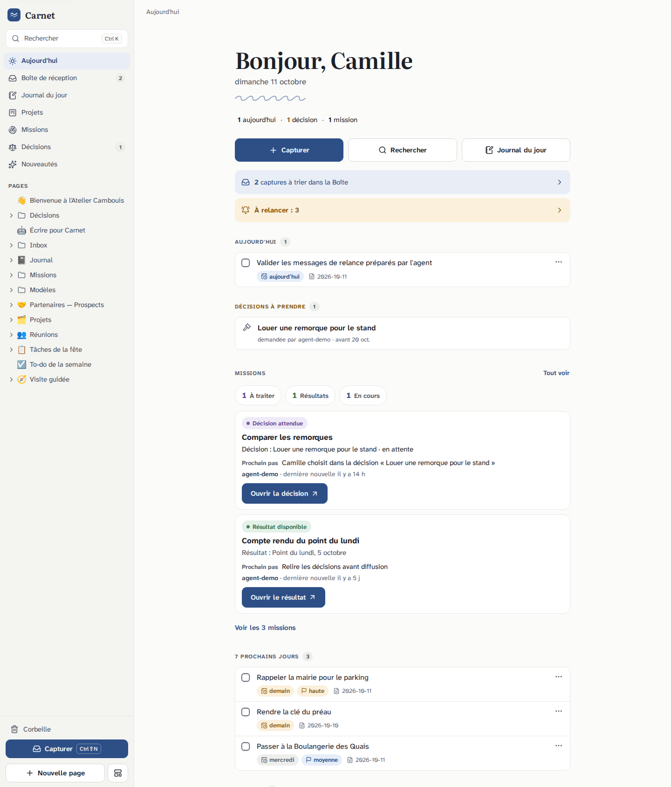
</p>

<p align="center">
  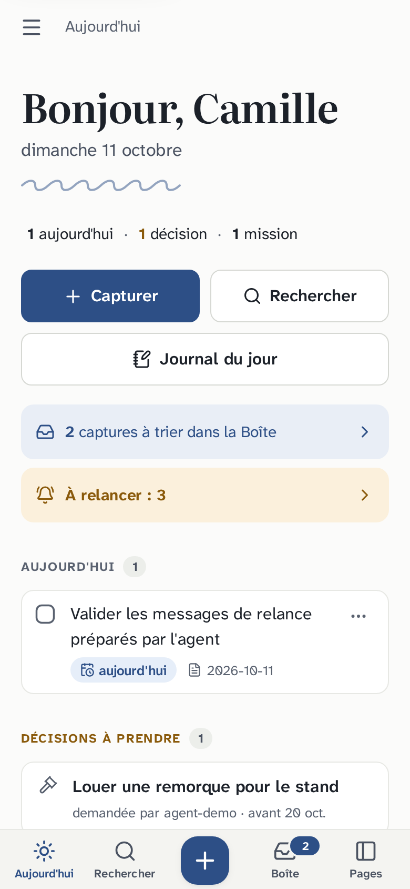
  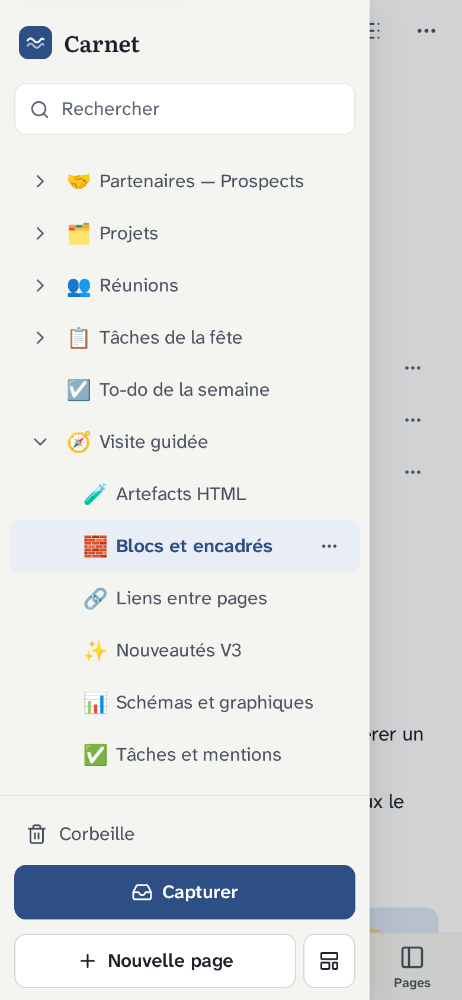
  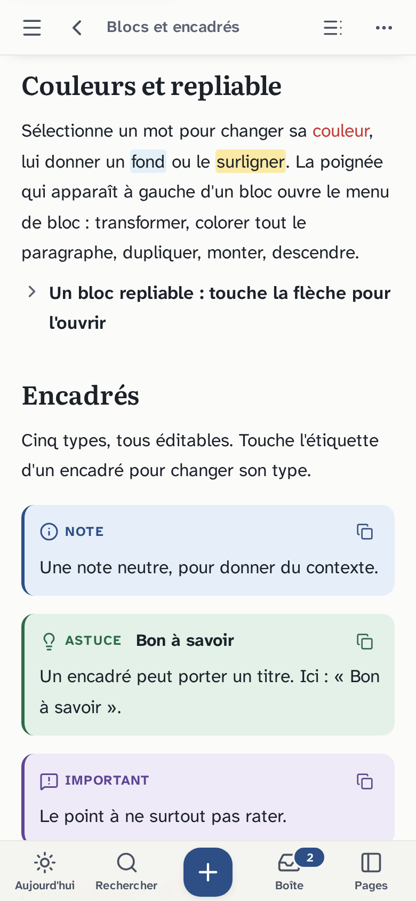
</p>

## Pourquoi

- **Tes agents écrivent déjà en Markdown.** Autant leur donner un endroit où l'écrire proprement, plutôt que de les brancher sur l'API d'un service tiers.
- **Tu veux une vraie interface**, agréable sur téléphone, pas un éditeur de texte brut : un arbre de pages, un menu `/`, des tableaux, des cases à cocher, des encadrés colorés.
- **Tu veux garder la main.** Des fichiers, git, aucun verrou. Si Carnet disparaît demain, tes notes sont toujours là, lisibles partout.
- **Tu veux de la sécurité sérieuse.** Un agent lit des mails et des pages web : un contenu piégé ne doit jamais pouvoir s'exécuter chez toi. Carnet isole tout ce qui est du code sur une autre origine.

## Ce que ça fait

- **Éditeur en blocs** (Tiptap 3, sans paquet payant). Le menu `/` en français : sous-page, lien vers une page, texte, titres, listes, tâche, citation, bloc repliable, séparateur, cinq encadrés, tableau, image, code, schéma, graphique, artefact, date du jour, sommaire. La poignée à gauche d'un bloc ouvre le **menu de bloc** : transformer en, couleur du texte et du fond, dupliquer, monter, descendre, supprimer, ou glisser le bloc ailleurs. Raccourcis à la Notion (`#`, `-`, `[]`, `>`, `+++`, ⌘D, ⌘⇧↑…), coloration du code (25 langages), liens `[[…]]`, enregistrement automatique.
- **Tes fichiers restent propres.** Une page ouverte sans modification n'est jamais réécrite ; quand tu modifies un bloc, seul ce bloc change dans le fichier. Les couleurs, le surlignage et le bloc repliable ont une écriture Markdown lisible ailleurs (`<span color="red">`, `==surligné==`, `<details>`).
- **Mise à jour en direct.** Un agent écrit, la page ouverte se met à jour en un peu plus d'un dixième de seconde. Si vous écrivez en même temps, rien n'est écrasé : un bandeau te laisse comparer, puis garder ta version, la sienne ou les deux.
- **Un arbre que tu ranges** : ordre manuel par glisser-déposer (rangé à part, dans `.carnet/ordre.json`, jamais dans tes pages), déplacer, dupliquer, icône et couverture de page, et sous le titre la liste des pages qui pointent vers celle-ci.
- **Corbeille** : supprimer envoie la page à la corbeille, avec « Annuler » pendant 8 secondes. Elle y reste 30 jours (réglable), avec aperçu et restauration à sa place.
- **Historique des versions** : les instantanés que tu prends, une version automatique après chaque pause de travail, et les versions git si ton dossier est un dépôt git (lu en lecture seule). Comparaison mot à mot, restauration en un geste (Carnet garde d'abord un instantané de la version actuelle). Réglages dans [docs/deploiement.md](docs/deploiement.md).
- **Aujourd'hui** : les tâches en retard, du jour et de la semaine de toutes les pages (cochables d'ici), les décisions à prendre, les missions des agents, les nouveautés, « À relire » (`statut: à relire` ou ta mention) et les pages récentes. Une **Boîte** pour capturer un texte ou un lien en un geste.
- **Bases** : des tableaux vivants de pages, filtrés et triés, au format d'Obsidian Bases (sous-ensemble, vue tableau), avec plusieurs vues et des cellules modifiables.
- **Projets** : tableau et kanban construits sur le frontmatter (`statut`, `echeance`, `responsable`, `priorite`). Changer un statut, ou glisser une carte, réécrit **une seule ligne** du fichier.
- **Schémas et graphiques déclaratifs** : des blocs ` ```mermaid ` et ` ```vega-lite ` rendus dans un cadre isolé.
- **Artefacts HTML** : un agent livre un tableau de bord ou un simulateur, Carnet l'affiche dans une carte avec aperçu vivant et plein écran, sans qu'il puisse toucher à tes pages ni sortir sur Internet.
- **Recherche** (⌘K) dans les titres et les contenus, sans se soucier des accents, avec les pages consultées récemment, un aperçu, et « Créer la page » quand rien ne correspond. Renommer ou déplacer une page met à jour les liens des autres pages.
- **Pensé pour le téléphone d'abord** : tiroir d'arbre, barre au-dessus du clavier, cibles tactiles de 44 px, thèmes clair et sombre automatiques, installable sur l'écran d'accueil, écran clair quand la connexion manque (jamais de page blanche, jamais une note périmée).
- **Impression et PDF** : une feuille d'impression soignée (menu « … » de la page, puis « Imprimer ou exporter en PDF »).
- **Léger et rapide** : un serveur Node sans base de données. Mesuré sur la V2 : le conteneur occupe environ 30 Mo de mémoire au repos ; une page s'ouvre en 75 ms depuis l'application et en 120 ms en rechargeant. Mesures détaillées dans [docs/architecture.md](docs/architecture.md#performances).

| Schémas et graphiques | Projets en kanban |
|---|---|
| <a href="docs/img/schemas-bureau.png">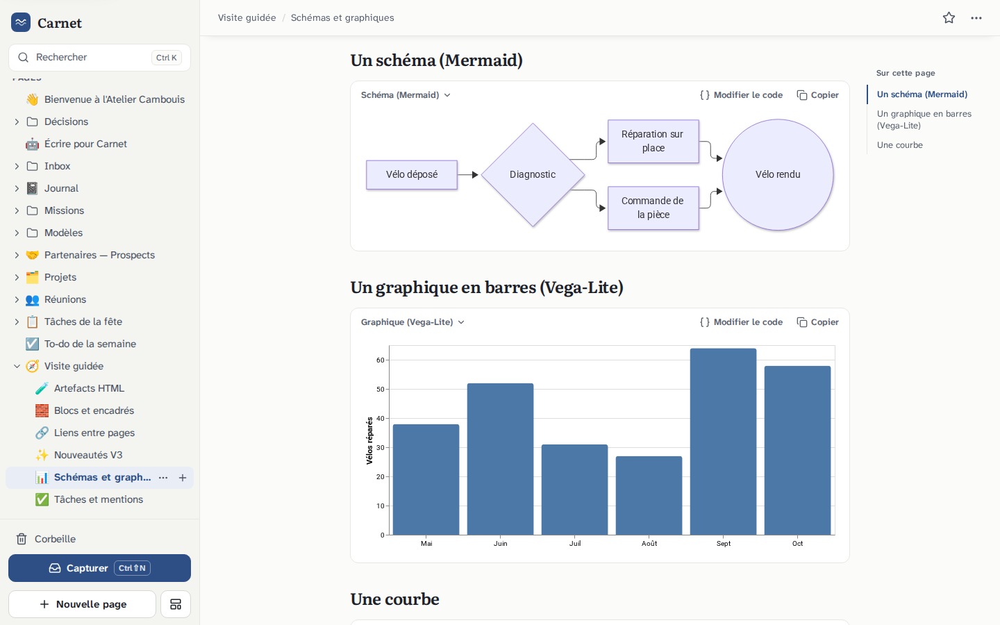</a> | <a href="docs/img/projets-kanban-bureau.png">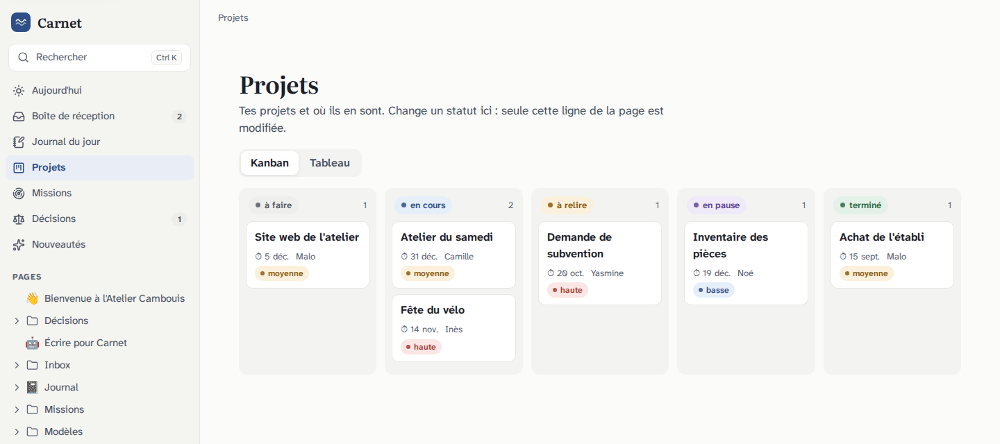</a> |
| **Le menu `/`** | **Le menu de bloc, la couverture et l'icône** |
| <a href="docs/img/menu-slash-bureau.png">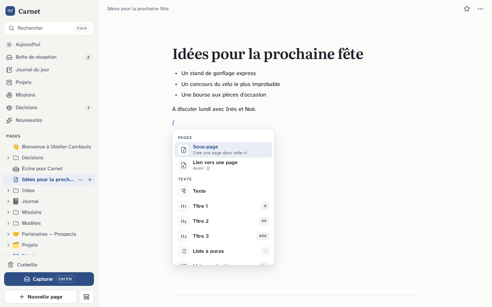</a> | <a href="docs/img/menu-bloc-bureau.png">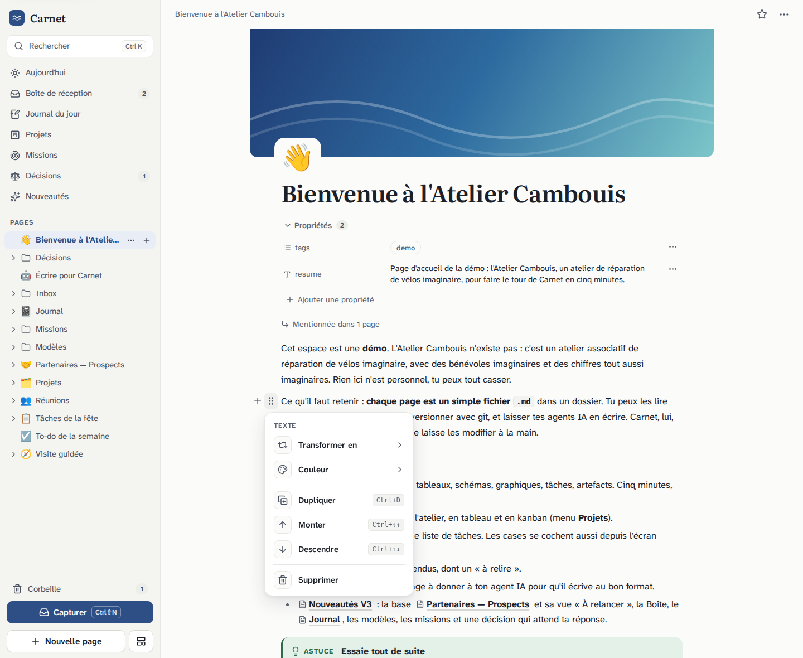</a> |
| **L'historique des versions** | **La corbeille** |
| <a href="docs/img/historique-bureau.png">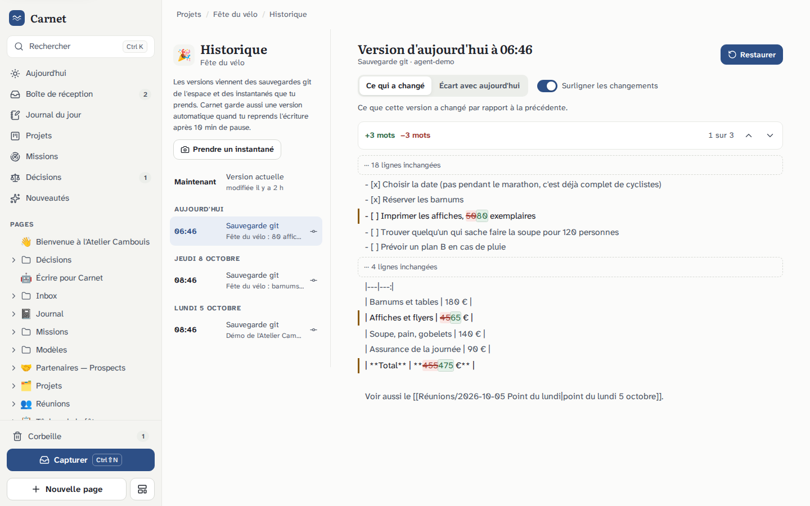</a> | <a href="docs/img/corbeille-bureau.png">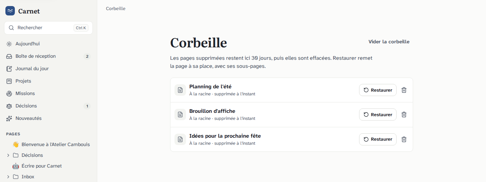</a> |
| **Un artefact HTML dans une page** | **Encadrés et tableau** |
| <a href="docs/img/artefact-bureau.png">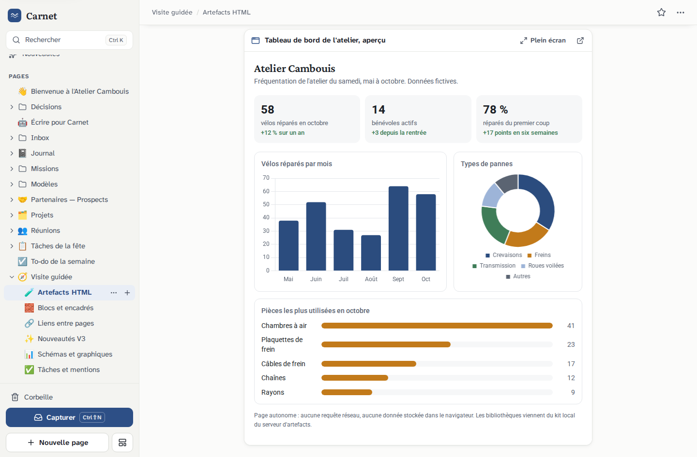</a> | <a href="docs/img/page-blocs-bureau.png">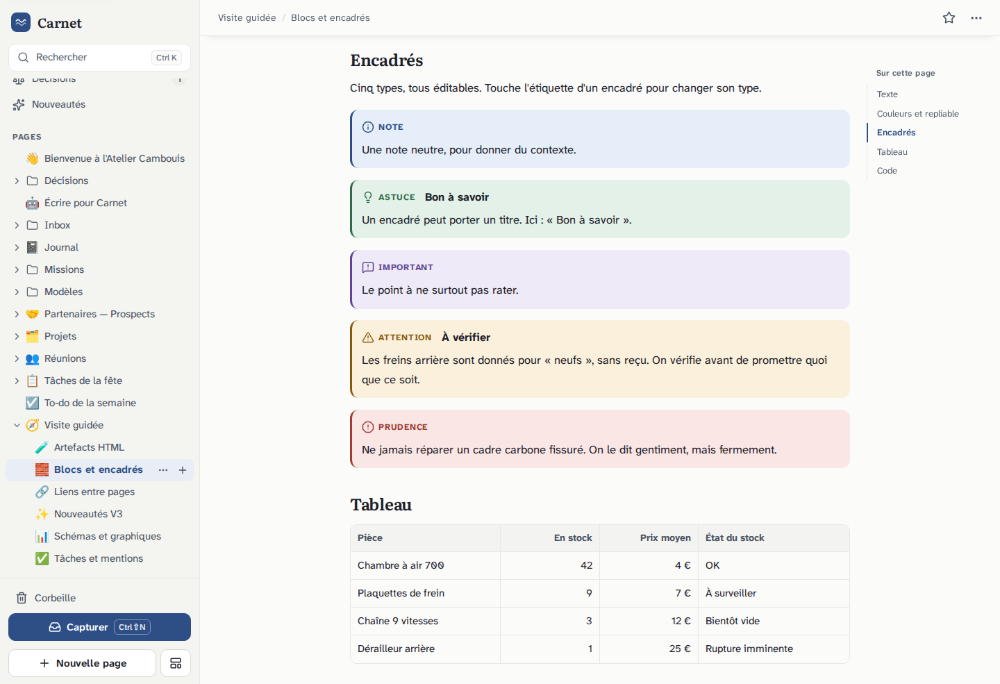</a> |

## Nouveautés de la V3

- **Aujourd'hui** remplace l'accueil : tâches en retard, du jour et des 7 prochains jours (format Obsidian Tasks, `📅 2026-10-12 ⏫`), décisions à prendre, missions, nouveautés, et pages à relire avec leur critère écrit en clair. Sur iPhone, une barre d'onglets : Aujourd'hui, Rechercher, ＋, Boîte, Pages.
- **Boîte** : ＋ (ou ⌘⇧N) capture un texte ou un lien dans une page de `Inbox/`. Tu tries ensuite : ouvrir, déplacer, ranger dans une base, corbeille. Le lien est enregistré, jamais téléchargé par le serveur.
- **Bases** : un bloc ` ```base ` affiche un tableau vivant de pages filtrées et triées, aux cellules modifiables (une seule propriété réécrite dans le fichier). Le format est un sous-ensemble d'Obsidian Bases, en vue tableau. Ce qui n'est pas pris en charge donne une erreur visible, jamais un tableau faux. Les dates relatives (`today() + "7d"`) permettent une vue « À relancer », dont le compte remonte dans Aujourd'hui.
- **Vues sans YAML** : créer, dupliquer, renommer ou supprimer une vue, ou enregistrer les filtres du moment comme nouvelle vue, depuis le menu de la base.
- **Pages** : modèles (dossier `Modèles/`, variables `{{date}}`, `{{heure}}`, `{{titre}}`), journal du jour (`Journal/AAAA-MM-JJ.md`), verrou (`verrou: true` : lecture seule dans Carnet), archive (`archive: true` : hors de la recherche et d'Aujourd'hui, jamais supprimée), bouton **Copier** sur les citations, les encadrés et les blocs de code.
- **Brouillons durables et conflits** : ce que tu tapes reste gardé dans le navigateur jusqu'à ce que le serveur confirme l'enregistrement, même après une coupure réseau, un rechargement ou un onglet planté, et un renvoi n'écrit jamais deux fois. Si un agent modifie la même page, rien n'est écrasé : tu compares, puis tu gardes ta version, la sienne ou les deux (copie de conflit). L'écran « Écritures en attente » montre ce qui n'est pas encore enregistré.
- **Nouveautés et retour à la version vue** : l'écran Nouveautés liste les pages modifiées hors de Carnet depuis ta dernière lecture, avec la différence exacte. « Marquer comme vu » enregistre la version que tu as vue ; « Revenir à la version marquée vue » annule d'un geste ce qu'un agent a changé (la version retirée reste dans l'historique).
- **Pour les agents** :
  - **Missions** (`type: mission`) : chaque agent tient une fiche (état, dernier signal, prochain pas, livrables). Carnet les classe (à arbitrer, résultats disponibles, en cours) et vérifie que le livrable annoncé existe.
  - **Décisions** (`type: decision`) : l'agent écrit une proposition ; tu approuves, demandes une correction ou refuses. Carnet fige la proposition, en garde l'empreinte et signe une attestation hors de ton dossier de pages, qu'un outil vérifie avant d'agir. Avec une clé d'accès (Face ID, Touch ID), l'attestation prouve un geste fait sur ton appareil.
  - **Dossier de rendez-vous** : sur une fiche qui liste ses `sources`, « Préparer » rassemble décisions, tâches ouvertes, livrables et notes récentes, sans IA ni réseau, chaque extrait renvoyant à sa source.
- **Aussi** : versions automatiques après une pause de travail, liens `[[Page#Titre]]` qui mènent au titre, visionneuse d'images plein écran, « Sur cette page » pour les longues pages, adresse collée en signet, page supprimée retrouvée dans la corbeille depuis son adresse.

| La Boîte | Une base et sa vue « À relancer » |
|---|---|
| <a href="docs/img/boite-bureau.png">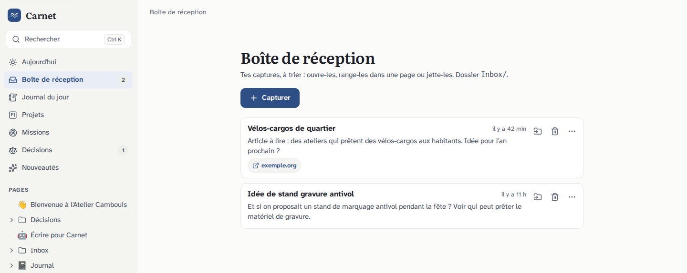</a> | <a href="docs/img/base-relancer-bureau.png">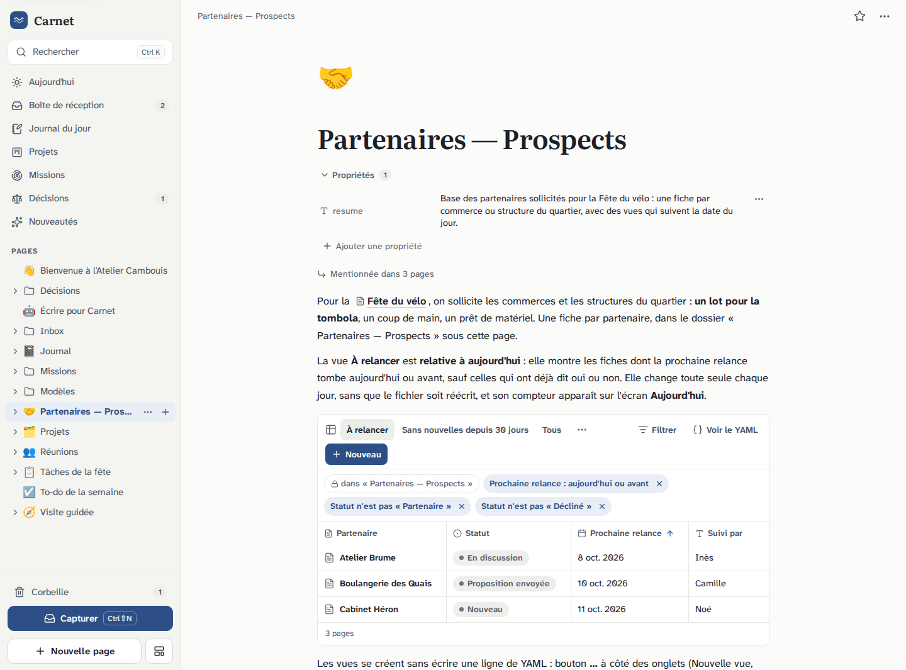</a> |
| **Les missions des agents** | **Une demande de décision** |
| <a href="docs/img/missions-bureau.png">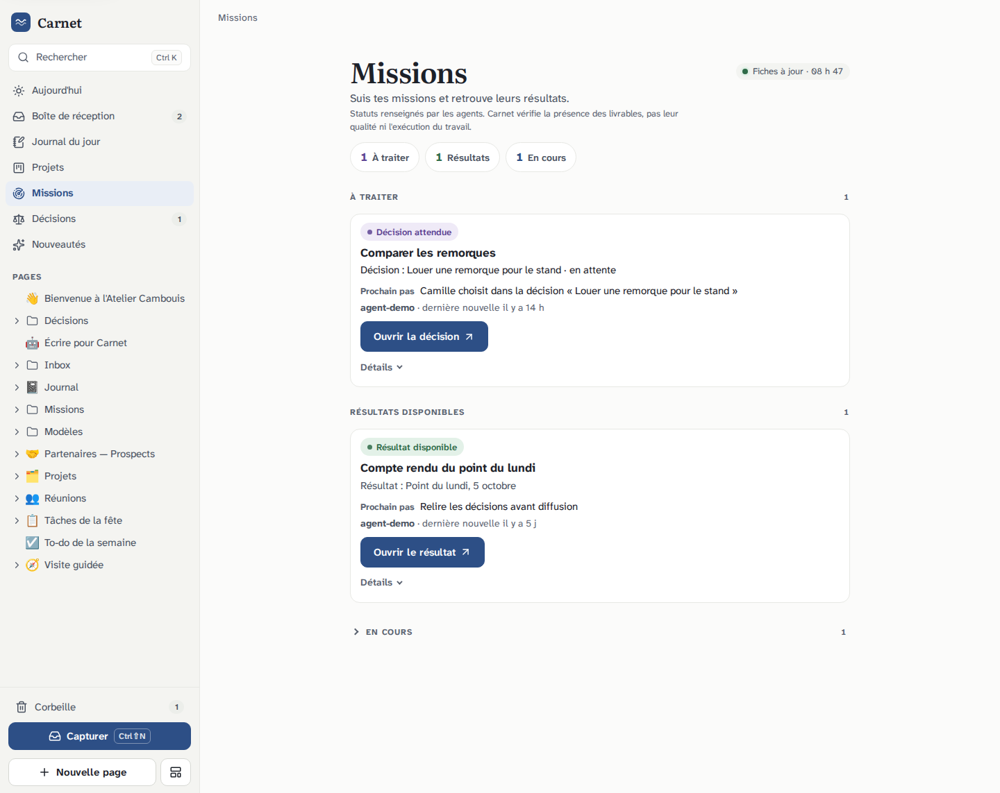</a> | <a href="docs/img/decision-bureau.png">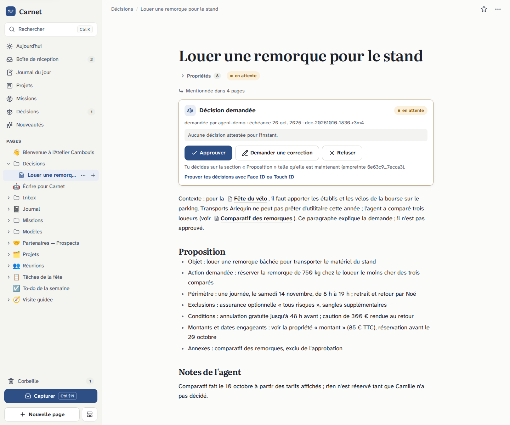</a> |

### Limites honnêtes

- **Pas encore essayé sur un vrai iPhone.** L'interface est testée en WebKit (le moteur de Safari) sous Linux et en Chromium, en 390×844 tactile émulé ; le clavier, le sélecteur de date natif, l'encoche et Face ID restent à vérifier sur un appareil.
- **Bases : un sous-ensemble d'Obsidian Bases écrit d'après sa documentation, jamais vérifié dans Obsidian lui-même**, en particulier le tri (`sort`) et la clé `carnet:`, qu'Obsidian pourrait signaler ou retirer en réenregistrant la base. Vue tableau seulement : ni cartes, ni kanban, ni calendrier, ni formules, ni regroupements. Évaluation sans index, confortable jusqu'à quelques milliers de pages.
- **Clés d'accès (WebAuthn) testées avec un authentificateur virtuel seulement** (Chromium, et un authentificateur logiciel côté serveur), jamais avec Face ID ou Touch ID réels. Une clé est liée au nom d'hôte : enregistrée pour une adresse, elle ne vaut pas pour une autre.
- **Attestations** : elles sont signées par une clé du serveur. Un programme qui tourne sous le même utilisateur système que Carnet peut lire cette clé et signer à sa place, et l'effacement de la toute dernière ligne du journal n'est pas détecté (une coupure au milieu l'est). C'est une protection contre l'erreur et l'agent naïf, pas contre un programme malveillant sur la même machine.
- **Déclarations** : l'auteur déclaré d'une modification (`maj_par`), l'état d'une mission ou le `statut` écrit d'une décision ne prouvent rien. Carnet vérifie qu'un livrable existe, pas sa qualité.
- **Brouillons** : ils vivent dans le navigateur où tu as tapé, pas sur tes autres appareils. Au-delà de ces brouillons, pas d'écriture hors ligne.
- **Récurrences** (🔁) affichées et conservées, jamais exécutées ; pas de rappels ni de notifications.
- **Verrou** : un drapeau dans le fichier, contre les fausses manipulations dans Carnet ; pas un contrôle d'accès.

## Architecture

```
Navigateur ── proxy authentifiant (Tailscale Serve, Caddy + Authelia…) ──┬─▶ carnet     (Node 22)  127.0.0.1:3020
                                                                         │      pages .md, API, interface, flux SSE
                                                                         └─▶ artefacts  (Python)   127.0.0.1:3006  AUTRE origine
                                                                                artefacts HTML, schémas, graphiques, kit local
```

Deux petits conteneurs durcis. **La vérité, ce sont tes fichiers `.md`.** Carnet signe de courts liens HMAC qui ouvrent les artefacts sur l'autre origine ; les deux services ne se parlent pas. Le détail est dans [docs/architecture.md](docs/architecture.md).

## Démarrage rapide (Docker)

```bash
git clone https://github.com/MisterBD/carnet.git
cd carnet
./scripts/initialiser.sh          # crée .env, la clé de signature (chmod 600) et le dossier d'état
docker compose up -d --build
```

Ouvre <http://127.0.0.1:3020> : tu arrives dans l'espace de démonstration (`demo/`, un atelier de vélos imaginaire). Pour utiliser tes propres notes, mets `CARNET_ESPACE_HOTE=/chemin/vers/tes/notes` dans `.env` puis `docker compose up -d`.

L'essai local tourne en mode développement (`CARNET_DEV=1`), **sans authentification, sur 127.0.0.1 seulement**. Pour l'ouvrir à tes autres appareils, mets un proxy qui authentifie devant : Tailscale Serve est le plus simple. Tout est expliqué, avec des exemples de configuration (Tailscale Serve, Caddy + Authelia, Caddy + oauth2-proxy), dans [docs/deploiement.md](docs/deploiement.md).

Tu passes de la V2 à la V3 ? Aucune migration de pages n'est nécessaire ; ce qui change (dossier d'état, nouvelles variables facultatives, clés d'accès) est décrit dans [Mettre à jour depuis la V2](docs/deploiement.md#mettre-à-jour-depuis-la-v2).

## Faire écrire tes agents

Donne à ton agent le fichier [docs/format-agents.md](docs/format-agents.md) (ou la page `demo/Écrire pour Carnet.md`, qui en est la version courte), ou colle-lui la section « À coller dans le AGENTS.md ». En résumé : une page Markdown avec un frontmatter court, le niveau le plus bas qui suffit (texte, tableau, encadré, schéma, graphique, artefact HTML en dernier recours), une écriture atomique, et jamais de contenu extérieur recopié en HTML brut. Le même guide décrit les formats de la V3 : tâches datées, captures, bases, modèles, missions, demandes de décision, dossier de rendez-vous, et la façon de vérifier une décision avant d'agir.

```md
---
title: Bilan du trimestre
icon: 📈
statut: à relire
tags: [rapport]
resume: "412 vélos réparés (+8 %), trois bénévoles font la moitié du travail."
---
# Bilan du trimestre

> [!WARNING] À vérifier
> Le chiffre de septembre n'a pas été confirmé.

- [ ] Confirmer septembre @camille
```

## Sécurité

Carnet affiche des pages écrites par des agents qui lisent des contenus non fiables. Son modèle de menace est détaillé dans [SECURITY.md](SECURITY.md). L'essentiel :

- **Rien d'exécutable sur l'origine de l'application** : le HTML brut d'une page est affiché comme du texte (seules quelques balises de mise en forme, en liste fermée, sont reconnues), aucun `.html`, `.svg`, `.js` ou `.css` n'est servi par l'application.
- **Les artefacts sont sur une autre origine**, dans un cadre `sandbox` à origine opaque, sans réseau (`connect-src 'none'`), ouverts par un lien signé de 15 minutes.
- **Pas de mot de passe** : l'identité vient d'un proxy authentifiant (Tailscale Serve, oauth2-proxy, Authelia…), avec une liste de comptes autorisés. **Ne l'expose jamais sans authentification.**
- **Une décision écrite dans un fichier ne prouve rien** : Carnet signe une attestation hors de ton dossier de pages pour chaque décision prise dans son interface ; avec une clé d'accès (WebAuthn), elle prouve un geste fait sur ton appareil. Une attestation n'autorise jamais à elle seule une action : l'outil qui agit la vérifie au moment d'agir.
- CSP stricte, anti-CSRF, chemins confinés, historique git lu sans shell et en lecture seule, conteneurs en lecture seule sans privilèges, aucune ressource externe, dépendances et images épinglées.

Une faille ? Signale-la en privé (onglet *Security* du dépôt), voir [SECURITY.md](SECURITY.md).

## Feuille de route

Carnet sert tous les jours à son auteur. La recette de bout en bout (`tests/recette.py`, 28 étapes, qui vérifient aussi les fichiers sur le disque) tourne en Chromium et en WebKit (le moteur de Safari), sur iPhone émulé et sur ordinateur, en clair et en sombre. Ce qui manque encore, et qu'on aimerait ajouter (rien n'est promis, les contributions sont bienvenues) :

- **Tests publiés** : la suite d'isolation du serveur d'artefacts (requêtes HTTP piégées, navigateurs) et les recettes de l'éditeur et de la navigation, à rendre indépendantes de l'installation de l'auteur.
- **Éditeur** : colonnes, taille et alignement des images, réduction des photos avant l'envoi, menu `@` (pages et dates), pièces jointes, sélection de plusieurs blocs, recherche dans la page.
- **Bases** : vues kanban, calendrier et galerie, relations, formules, regroupements.
- **Tâches** : récurrences exécutées, rappels, flux `.ics` des échéances.
- **Hors ligne** : écrire sans connexion au-delà des brouillons gardés par le navigateur.
- **Import** depuis un export Notion : pages, bases et rapport de ce qui ne passe pas.
- **Navigation** : barre latérale redimensionnable, défilement de l'arbre pendant un glisser.
- **Sécurité** : un secret partagé entre le proxy et Carnet, en plus de l'en-tête d'identité ; la clé et le journal des attestations sous un autre utilisateur système que celui des agents.
- **iPhone réel** : le clavier, l'appui long, l'export PDF, les clés d'accès et la barre d'onglets sont testés en émulation ; les retours sur appareil sont précieux.

Hors périmètre, volontairement : la collaboration en temps réel, une base de données, la gestion des mots de passe, l'exécution de code dans les pages. Voir [CONTRIBUTING.md](CONTRIBUTING.md).

## Contribuer, licence

Les contributions sont les bienvenues : [CONTRIBUTING.md](CONTRIBUTING.md) explique comment lancer les tests, ce qu'on attend d'une pull request, et la règle de licence (jamais de code GPL, AGPL ou propriétaire). Les licences des dépendances, des polices et des icônes sont dans [THIRD_PARTY_NOTICES.md](THIRD_PARTY_NOTICES.md).

Carnet est publié sous [licence MIT](LICENSE). Copyright (c) 2026 Dimitri Foucault.

---

<a id="english"></a>

# Carnet (English)

**A free, self-hosted "home-made Notion" where your AI agents write in Markdown.**

Carnet is a block-based page editor (page tree, `/` menu, tables, checkboxes, diagrams, charts) on top of **a plain folder of Markdown files**. No database, no account, no cloud: your notes stay files you can read, version with git and back up, and that your AI agents read and write directly. When an agent edits the page you have open, it updates live in front of you. V3 adds what you need to oversee your agents' work: a Today screen, a capture inbox, bases, missions and attested decisions (see [What's new in V3](#whats-new-in-v3)). The interface is in French; the format and the documentation of the writing rules are described below and in `docs/`.

> The project, its UI and most documentation are written in French. Issues and pull requests in English are welcome.

### Why

- Your agents already write Markdown. Give them a place to write it properly instead of wiring them to a third-party API.
- You want a real interface, pleasant on a phone, not a raw text editor.
- You want to stay in control: files and git, no lock-in. If Carnet disappears, your notes are still readable everywhere.
- You want serious security: an agent that reads emails and web pages must never be able to run injected code on your device. Carnet isolates everything that is code on a separate origin.

### Features

- Block editor built on Tiptap 3 (no paid packages): a French `/` menu, a block menu behind the drag handle (turn into, text and background color, duplicate, move up or down, delete, drag), Notion-style shortcuts, code highlighting (25 languages), `[[page links]]`, autosave.
- **Byte-faithful Markdown**: a page opened without changes is never rewritten, and when you edit a block only that block changes in the file. Colors, highlights and collapsible blocks use portable forms (`<span color="red">`, `==highlight==`, `<details>`).
- **Live updates** when an agent writes (a little over 0.1 s on the same machine). If you both write at the same time, nothing is overwritten: compare, then keep yours, theirs or both.
- Page tree with manual drag-and-drop ordering (stored in `.carnet/ordre.json`, never in your pages), duplicate and move, page icons and covers, backlinks.
- **Trash** with an 8-second undo, 30-day retention (configurable), preview and restore.
- **Version history**: manual snapshots, an automatic version after each pause, plus git versions when your folder is a git repository (read-only). Word-level diff and one-click restore. Settings in `docs/deploiement.md`.
- **Today** screen (overdue, today's and this week's tasks across pages, decisions waiting, agents' missions, changes, "to review" list, recent pages), a capture **Inbox**, **bases** (live tables of pages in a subset of the Obsidian Bases format), **Projects** table and kanban driven by frontmatter, accent-insensitive search with recent pages and preview.
- Declarative **Mermaid** diagrams and **Vega-Lite** charts rendered in an isolated frame.
- **HTML artifacts** delivered by agents (dashboards, simulators) shown in a sandboxed card: no network, no access to your pages.
- Mobile-first: tree drawer, bar above the keyboard, 44 px touch targets, automatic light and dark themes, installable (PWA), a clear offline screen, print and PDF export.
- Light: one Node server with a single dependency (`yaml`), no database. Measured on V2: about 30 MB of RAM for the container at rest; a page opens in 75 ms from within the app.

### What's new in V3

- **Today** replaces the home screen: overdue tasks, today's and the next 7 days' (Obsidian Tasks format, `📅 2026-10-12 ⏫`), decisions waiting for you, missions, changes, and pages to review with the rule spelled out. On iPhone, a tab bar: Today, Search, ＋, Inbox, Pages.
- **Inbox**: ＋ (or ⌘⇧N) captures a text or a link as a page in `Inbox/`. You sort it later: open, move, file it into a base, trash. The link is stored, never fetched by the server.
- **Bases**: a ` ```base ` block shows a live table of filtered and sorted pages with editable cells (a single property is rewritten in the file). The format is a subset of Obsidian Bases, table view only. Anything unsupported shows a visible error, never a wrong table. Relative dates (`today() + "7d"`) make a "follow up" view possible, and its count shows up in Today.
- **Views without YAML**: create, duplicate, rename or delete a view, or save the current filters as a new view, from the base menu.
- **Pages**: templates (`Modèles/` folder, `{{date}}`, `{{heure}}`, `{{titre}}`), daily journal (`Journal/YYYY-MM-DD.md`), lock (`verrou: true`: read-only in Carnet), archive (`archive: true`: out of search and Today, never deleted), a **Copy** button on quotes, callouts and code blocks.
- **Durable drafts and conflicts**: what you type is kept in the browser until the server confirms the save, even after a network cut, a reload or a crashed tab, and a retry never writes twice. If an agent edits the same page, nothing is overwritten: you compare, then keep yours, theirs or both (conflict copy). A "pending writes" screen shows what is not saved yet.
- **Changes and going back to the seen version**: the Changes screen lists pages modified outside Carnet since you last read them, with the exact diff. "Mark as seen" records the version you saw; "Go back to the version marked as seen" undoes an agent's change in one step (the removed version stays in the history).
- **For agents**:
  - **Missions** (`type: mission`): each agent keeps a card (state, last signal, next step, deliverables). Carnet sorts them (to decide, results available, in progress) and checks that the announced deliverable exists.
  - **Decisions** (`type: decision`): the agent writes a proposal; you approve, ask for changes or refuse. Carnet freezes the proposal, keeps its fingerprint and signs an attestation outside the notes folder, which a tool checks before acting. With a passkey (Face ID, Touch ID), the attestation proves a gesture made on your device.
  - **Meeting brief**: on a page that lists its `sources`, "Prepare" gathers decisions, open tasks, deliverables and recent notes, with no AI and no network, each excerpt linking back to its source.
- **Also**: automatic versions after a pause, `[[Page#Heading]]` links that scroll to the heading, full-screen image viewer, an "On this page" outline for long pages, pasted URLs as bookmarks, a deleted page found in the trash from its address.

Screenshots of the Inbox, a base, the Missions screen and a decision request are in the French section above.

#### Honest limits

- **Not tried on a real iPhone yet.** The UI is tested in WebKit (Safari's engine) on Linux and in Chromium with an emulated 390×844 touch screen; keyboard, native date picker, notch and Face ID still need a real device.
- **Bases implement a subset of Obsidian Bases written from its documentation, never checked in Obsidian itself**, especially sorting (`sort`) and the `carnet:` key, which Obsidian might flag or drop when it saves the base. Table view only: no cards, kanban, calendar, formulas or grouping. No index: fine up to a few thousand pages.
- **Passkeys (WebAuthn) were tested with a virtual authenticator only** (Chromium, plus a software authenticator on the server side), never with a real Face ID or Touch ID. A passkey is bound to the host name: registered for one address, it does not work for another.
- **Attestations** are signed with a server key. A program running as the same system user as Carnet can read that key and sign; deleting the very last line of the attestation log is not detected (a gap in the middle is). This protects against mistakes and naive agents, not against a malicious program on the same machine.
- **Declarations**: the declared author of a change (`maj_par`), a mission's state or a decision's written `statut` prove nothing. Carnet checks that a deliverable exists, not its quality.
- **Drafts** live in the browser you typed in, not on your other devices. Beyond those drafts, there is no offline editing.
- **Recurring tasks** (🔁) are shown and preserved, never generated; no reminders or notifications.
- **Lock** is a flag in the file against accidental edits in Carnet, not access control.

### Architecture

Two small hardened containers: `carnet` (Node 22: pages, API, UI, SSE) and `artefacts` (Python standard library: sandboxed HTML artifacts, diagrams, a pinned local library kit) on a **different origin**. Short HMAC-signed links (15 minutes) open the artifacts; the two services never talk to each other. See [docs/architecture.md](docs/architecture.md) (French).

### Quick start (Docker)

```bash
git clone https://github.com/MisterBD/carnet.git
cd carnet
./scripts/initialiser.sh          # creates .env, the signing key (chmod 600) and the state folder
docker compose up -d --build
```

Open <http://127.0.0.1:3020>: you land in the demo space (`demo/`). To use your own notes, set `CARNET_ESPACE_HOTE=/path/to/your/notes` in `.env`, then `docker compose up -d`.

The local trial runs in development mode (`CARNET_DEV=1`): **no authentication, 127.0.0.1 only**. To reach it from your other devices, put an **authenticating proxy** in front (Tailscale Serve is the simplest). Examples for Tailscale Serve, Caddy + Authelia and Caddy + oauth2-proxy are in [docs/deploiement.md](docs/deploiement.md) (French), along with upgrade notes from V2 (no page migration needed).

### Security

Carnet has no passwords: identity comes from an authenticating proxy that sets an HTTP header, plus an allow-list of accounts. **Never expose it without authentication.** Page content never executes (raw HTML is shown as text; only a closed list of formatting tags is recognized), artifacts run in a sandboxed, network-less frame on another origin, git history is read without a shell, and everything is hardened (strict CSP, CSRF protection, confined paths, read-only containers, pinned dependencies). A decision written in a Markdown file proves nothing: Carnet signs an attestation outside the notes folder for each decision taken in its UI, and with a passkey (WebAuthn) it proves a gesture made on your device; an attestation alone never authorizes an action. Threat model and how to report a vulnerability privately: [SECURITY.md](SECURITY.md).

### Roadmap

Not done yet, and welcome as contributions (nothing is promised): publishing the artifact-server isolation suite and the editor and navigation end-to-end suites, columns, image resizing and alignment, an `@` menu for pages and dates, attachments, multi-block selection, in-page search, kanban, calendar and gallery views for bases, recurring tasks and reminders, offline editing, a Notion import, a resizable sidebar, a shared secret between the proxy and Carnet, and feedback from real iPhones. Deliberately out of scope: real-time multi-user collaboration, a database, password management, code execution in pages.

### Contributing and license

See [CONTRIBUTING.md](CONTRIBUTING.md). Never copy GPL, AGPL, BSL or proprietary code. Third-party licenses are listed in [THIRD_PARTY_NOTICES.md](THIRD_PARTY_NOTICES.md).

Released under the [MIT license](LICENSE). Copyright (c) 2026 Dimitri Foucault.
