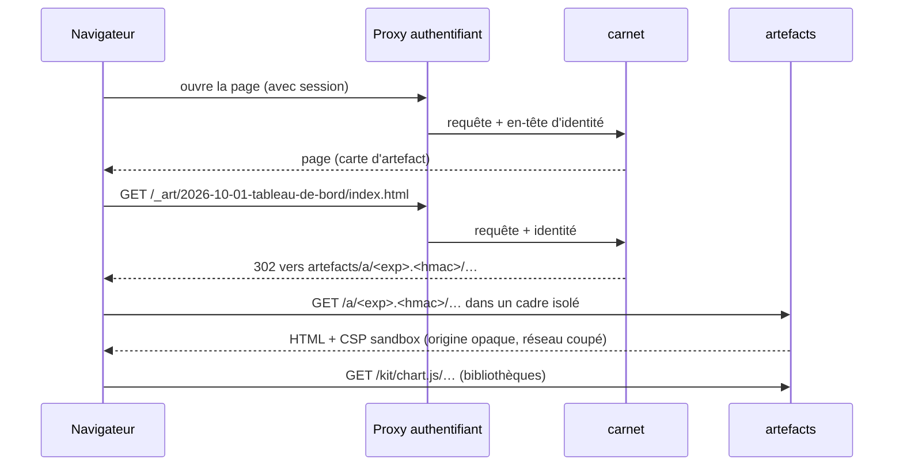

# Architecture

Carnet est un éditeur de pages en blocs, façon Notion, posé sur **un dossier de fichiers Markdown**. Ce document explique comment c'est construit et pourquoi, pour que tu puisses relire, auditer et contribuer.

## Principes

1. **La vérité, ce sont les fichiers `.md`.** Pas de base de données, pas de format intermédiaire. Un humain, un script, un agent IA ou git peuvent lire et écrire les mêmes fichiers. Carnet est une façade.
2. **Un humain et des agents écrivent au même endroit.** Quand un agent modifie la page ouverte, elle se met à jour sous les yeux de la personne. Quand la personne écrit, seul le bloc touché change dans le fichier.
3. **Les pages ne s'exécutent jamais.** Elles sont écrites par des agents qui lisent des contenus non fiables. Carnet n'interprète aucun HTML, ne sert aucun fichier actif depuis son origine, et isole tout ce qui est du code (artefacts, schémas, graphiques) sur une autre origine, sans réseau.
4. **Simple à héberger.** Deux petits conteneurs durcis (environ 30 Mo et 20 Mo de mémoire au repos), aucune base, aucun service externe, aucune ressource chargée depuis Internet.
5. **Une personne, ou un petit cercle de confiance.** Pas de collaboration en temps réel : deux écritures simultanées donnent un bandeau de conflit (garder l'une, l'autre, ou les deux dans une copie), jamais une fusion silencieuse.
6. **Chaque écriture se justifie.** Depuis la V3, toutes les écritures de Carnet passent par une seule porte : révision attendue, idempotence, journal d'attribution hors de l'espace. Un geste qui engage (une décision) laisse en plus une attestation signée, hors de l'espace : le Markdown seul est une déclaration, jamais une preuve.

## Vue d'ensemble

```
Navigateur (ordinateur, téléphone)
        │ HTTPS
        ▼
Proxy authentifiant : Tailscale Serve, ou reverse proxy + oauth2-proxy / Authelia…
(vérifie qui tu es, pose l'identité dans un en-tête HTTP)
        │                                         │
        ▼                                         ▼
carnet (Node 22)                          artefacts (Python, bibliothèque standard)
127.0.0.1:3020                            127.0.0.1:3006, AUTRE origine
 ├─ /          interface (build statique)   ├─ /a/<jeton>/…    artefacts HTML, jeton HMAC court
 ├─ /api/*     JSON, flux SSE               ├─ /rendu/mermaid  schémas, cadre isolé
 ├─ /_art/*    signe un lien, redirige ───▶ ├─ /rendu/vega-lite
 └─ dossier de pages .md (la vérité)        ├─ /kit/…          bibliothèques épinglées
                                            └─ /sante
```

Les deux services ne se parlent pas : ils sont sur des réseaux Docker distincts. Ils partagent seulement une **clé secrète** (lecture seule) qui sert à signer et vérifier les liens d'artefacts, et le dossier `artefacts/` de l'espace (lecture seule pour le serveur d'artefacts).

## Le serveur Carnet

Node 22, TypeScript exécuté directement (types retirés à la volée, aucune étape de compilation), `node:http` seul. **Une seule dépendance** : `yaml`.

| Module | Rôle |
|---|---|
| `main`, `app` | démarrage, arrêt propre, aiguillage des requêtes (`/sante`, `/api/*`, `/_art/*`, fichiers statiques) |
| `config` | lit les variables d'environnement une fois au démarrage, valide tout (voir [deploiement.md](deploiement.md)) |
| `securite` | identité, contrôle du `Host` (anti DNS-rebinding), anti-CSRF, confinement des chemins, en-têtes de sécurité, types de fichiers |
| `espace` | index en mémoire des pages, surveillance du disque (un `inotify` par dossier visible, rebalayage de sécurité toutes les 60 s), arbre trié, recherche |
| `api` | table des routes JSON : arbre, pages, recherche, accueil, projets, tâches, métadonnées, images, favoris, corbeille, historique, rangement, bases, propriétés ; branche les routes des modules V3 ci-dessous |
| `corbeille` | `.corbeille/` de l'espace : mise à la corbeille, liste, aperçu, restauration à la même place, effacement, purge automatique |
| `historique` | versions d'une page lues dans git (lecture seule) et instantanés pris à la demande, rangés hors de l'espace |
| `ordre` | ordre manuel de l'arbre, dans `.carnet/ordre.json` (jamais dans les pages) |
| `liens` | rétroliens (« Mentionnée dans N pages ») et aperçu d'une page pour la recherche |
| `markdown` | extraction des liens et des tâches, détection des mentions, réécriture des liens après un renommage |
| `sse` | flux d'événements en direct (`modif`, `arbre`), battement régulier, nombre de flux plafonné (`CARNET_MAX_SSE`) |
| `art` | signature des liens d'artefacts (`/_art`), liste des artefacts |
| `disque` | écritures atomiques, lectures confinées |
| `statique` | sert le build de l'interface avec les bons en-têtes |
| `http` | réponses JSON, erreurs, journal (méthode, route, statut, durée, identité ; jamais de contenu) |
| **Ajouts de la V3** | |
| `ecriture` | **porte d'écriture unique** : toute écriture de page passe par elle (voir « Écriture contrôlée ») |
| `journal-ecritures` | journaux durables hors de l'espace : attribution des écritures, intentions (reprise après panne), résultats des requêtes idempotentes |
| `attestations` | attestations signées (HMAC) des décisions, chaînées par demande, hors de l'espace |
| `cles`, `admin-cles` | clés d'accès WebAuthn (enregistrement par code à usage unique, vérification des assertions) ; commande d'administration hors de l'application |
| `decisions`, `demandes` | empreinte et preuve d'une page `type: decision` ; liste, lecture et geste (approuver, demander une correction, refuser) |
| `nouveautes`, `agents` | pages modifiées hors de Carnet depuis la version marquée vue, par lecteur ; routes des décisions, des nouveautés, des fichiers des agents et des clés d'accès |
| `fiabilite` | copie de conflit, retour à la version marquée vue, écritures restées indéterminées après une panne |
| `aujourdhui`, `routes-aujourdhui` | écran Aujourd'hui (tâches datées classées dans le fuseau du carnet), Boîte de réception, captures |
| `bases`, `bases-yaml`, `analyseur-yaml` | blocs ` ```base ` : lecture, exécution d'une vue tableau sur l'index, réécriture chirurgicale du YAML ; analyseur YAML 1.2 des propriétés |
| `pages` | modèles (`Modèles/`) et journal du jour (`Journal/AAAA-MM-JJ.md`) |
| `missions` | fiches `type: mission` lues en lecture seule (déclaré, observé, vérifié) |
| `preparation` | dossier de rendez-vous : assemblage déterministe d'extraits à partir des `sources` d'une fiche |

### Écritures

Une écriture est : fichier temporaire caché dans le dossier cible, `fsync`, mêmes permissions que l'original, `rename`, `fsync` du dossier. Une personne qui ouvre le fichier au même moment voit l'ancienne ou la nouvelle version, jamais un fichier à moitié écrit. Les agents sont invités à faire pareil (voir [format-agents.md](format-agents.md)).

Dans l'espace, Carnet n'écrit que des pages `.md` (y compris les captures de la Boîte, les journaux du jour et les pages créées depuis un modèle), les images envoyées (dans `_assets/`), le fichier de rangement `.carnet/ordre.json` et le contenu de `.corbeille/`. Tout le reste va dans le dossier d'état (`CARNET_ETAT`), hors de l'espace : favoris, instantanés, journaux d'écriture, attestations, clés d'accès, état « vu » des nouveautés.

### Écriture contrôlée

Depuis la V3, une seule porte d'écriture (`server/src/ecriture.ts`) fait toutes les écritures de pages : enregistrement, case cochée, propriété, cellule de base, capture, décision, renommage, déplacement, mise à la corbeille, restauration. Sous le verrou des mutations, elle enchaîne :

1. **Idempotence.** Chaque geste porte un identifiant (`X-Carnet-Requete`, un UUID choisi par le client et réutilisé à chaque nouvel essai). Un identifiant déjà traité renvoie le même résultat (`rejoue: true`) sans rien réécrire ; le même identifiant pour une autre opération donne `409 requete_reutilisee`. Les résultats sont gardés 7 jours hors de l'espace et relus au démarrage : une réponse perdue suivie d'un renvoi ne crée jamais de seconde capture ni de seconde décision.
2. **Révision attendue.** Le fichier est relu et comparé à la révision envoyée par le client. S'il a changé : `412` avec la version actuelle. « Garder la mienne » ne passe pas par un écrasement aveugle : le client renvoie l'`ETag` reçu dans le `412` avec `ecraser: true`, et la version écrasée est d'abord mise en instantané.
3. **Transformation pure.** Le changement est calculé sur le contenu actuel, sans effet de bord. Une donnée invalide donne `422` et rien n'est écrit ; un résultat identique n'est pas écrit (`inchange: true`).
4. **Verrou de page.** Sur une page `verrou: true`, les écritures de contenu sont refusées (`423 page_verrouillee`), sauf le geste explicite qui retire le verrou. Les agents gardent la main sur le fichier lui-même.
5. **Intention durable, puis écriture.** Une intention est écrite et synchronisée sur le disque avant de toucher l'espace, puis l'écriture atomique (avec une dernière vérification de la révision juste avant le `rename`), l'index, le flux SSE, le journal d'attribution, l'attestation éventuelle, et enfin la validation de l'intention. Au redémarrage, une intention sans validation est complétée si le fichier est déjà dans l'état visé, abandonnée s'il est resté dans l'état d'avant, et sinon signalée comme « indéterminée » à l'écran concerné.

Le **journal d'attribution** (`CARNET_ETAT/journal/<espace>/ecritures.jsonl`, une ligne par écriture, rotation à 10 Mo) distingue trois choses : l'identité vérifiée de la requête (en-tête du proxy), un client authentifié séparément (réservé, vide pour l'instant) et l'auteur **déclaré** par le fichier (`maj_par`), qui n'est jamais une preuve.

Limite assumée : le verrou ne protège que les écrivains de Carnet. Un écrivain externe (éditeur, git, agent) qui écrit dans les quelques millisecondes entre la dernière vérification et le `rename` n'est pas détecté.

### Concurrence

Chaque page a un `ETag`. `PUT /api/page` exige `If-Match` (l'écrasement aveugle `If-Match: *` est refusé) : si le fichier a changé entre-temps, le serveur répond `412` avec le contenu actuel. L'interface affiche alors le bandeau « modifiée ailleurs » : recharger la version de l'autre, garder la sienne, ou **garder les deux** (`POST /api/page/conflit` crée une copie « <Titre> (conflit AAAA-MM-JJ HHhMM) », jamais d'écrasement). Si l'autre version est verrouillée, « garder la mienne » n'est pas proposé. La création utilise `If-None-Match: *`.

### Événements en direct

Le serveur surveille le dossier, regroupe les événements (120 ms) et les pousse en SSE (`GET /api/evenements`). Le flux ne transporte que des noms d'événements, des chemins et des `ETag` (`modif`, `arbre`), jamais de contenu : l'interface relit ensuite la page par l'API, avec les mêmes contrôles qu'une lecture ordinaire. Un battement régulier garde la connexion ouverte à travers les proxys, le navigateur se reconnecte seul, et le nombre de flux simultanés est plafonné (`CARNET_MAX_SSE`). L'interface recharge la page ouverte si elle n'a pas de modification locale, sinon elle affiche le bandeau de conflit. Une écriture d'agent apparaît à l'écran en 0,13 s environ sur la même machine (voir « Performances »), plus le temps du réseau.

### API

Toutes les mutations exigent l'en-tête `X-Carnet: 1`. Les écritures acceptent `X-Carnet-Requete`, l'identifiant d'idempotence du geste, que l'interface envoie à chaque geste ; il est obligatoire pour les gestes qu'on ne doit jamais faire deux fois (décision, retour à une version vue, conservation d'un dossier de rendez-vous).

| Domaine | Routes |
|---|---|
| Pages | `GET /api/config` · `GET /api/arbre` · `GET\|PUT /api/page?chemin=` · `POST /api/page` (nouvelle page ou sous-page) · `POST /api/renommer` · `POST /api/deplacer` · `POST /api/placer` (ranger avant, après ou dans une page) · `POST /api/dupliquer` · `POST /api/supprimer` (vers la corbeille) |
| Lecture | `GET /api/recherche?q=` · `GET /api/apercu?chemin=` · `GET /api/retroliens?chemin=` · `GET /api/accueil` · `GET /api/projets` · `GET /api/artefacts` · `GET /api/couvertures?page=` · `GET /api/fichier?chemin=` · `GET /api/evenements` (SSE) |
| Petites écritures | `POST /api/tache` (une case) · `POST /api/meta` (une ligne du frontmatter) · `POST /api/images?page=` · `GET\|PUT /api/favoris` |
| Corbeille | `GET /api/corbeille` · `GET /api/corbeille/apercu?id=` · `POST /api/corbeille/restaurer` · `POST /api/corbeille/effacer` (un élément, ou tout) |
| Historique | `GET /api/historique?chemin=` · `GET /api/version?chemin=&id=` · `POST /api/instantane` · `POST /api/restaurer-version` |
| Aujourd'hui, Boîte | `GET /api/aujourdhui` (tâches datées classées, à relire, récents) · `GET /api/boite` (captures) · `POST /api/capture` (une page par capture dans `CARNET_INBOX`) |
| Bases et propriétés | `GET /api/base` (bloc ` ```base ` d'une page, vue exécutée) · `POST /api/base/evaluer` (même chose pour un YAML en cours d'édition, sans rien écrire) · `POST /api/base/reecrire` (nouveau YAML après un changement de filtre, de tri ou de vue, ou `422` s'il ne peut pas être conservé) · `POST /api/base/dossier` (dossier d'une nouvelle base) · `POST /api/base/entree` (nouvelle entrée) · `GET /api/bases/destinations` (bases où ranger une page) · `GET /api/proprietes` · `POST /api/propriete` (une propriété, rien d'autre) |
| Pages (V3) | `GET /api/modeles` · `POST /api/page/modele` (page depuis un modèle) · `POST /api/journal` (journal du jour, créé ou rouvert) · `POST /api/page/conflit` (copie de conflit) |
| Agents | `GET /api/missions` (lecture seule) · `GET\|POST /api/decisions` (liste ; nouvelle demande depuis le modèle) · `GET /api/decision` (proposition, empreinte, preuve, historique vérifié) · `POST /api/decision/defi` · `POST /api/decision` (le geste) · `GET /api/attestations` · `GET /api/techniques` (fichiers des agents) |
| Nouveautés | `GET /api/nouveautes` · `GET /api/nouveaute` (comparaison avec la version vue) · `POST /api/nouveautes/vu` · `GET\|POST /api/nouveautes/retour` (aperçu, puis retour à la version vue) |
| Dossier de rendez-vous | `GET /api/preparation` (assemblage, sans rien écrire) · `GET /api/preparation/etat` (à jour ou à rafraîchir) · `POST /api/preparation/conserver` (en faire une page `type: preparation`) |
| Clés d'accès | `GET /api/cles` · `POST /api/cles/defi` · `POST /api/cles` (enregistrement, avec un code d'enrôlement) |
| Fiabilité | `GET /api/ecritures/indeterminees` · `POST /api/ecritures/indeterminees/traiter` |
| Autres | `GET /_art/<chemin>` (lien signé vers le serveur d'artefacts) · `GET /sante` (sans identité) |

### Corbeille

Supprimer une page la déplace, avec ses sous-pages, dans `.corbeille/<AAAAMMJJ-HHMMSS-xxxx>/<chemin d'origine>`, à côté d'un `.meta.json` (chemin, titre, icône, date, nombre de sous-pages, identité). L'interface propose « Annuler » pendant 8 secondes, puis la page **Corbeille** liste les éléments avec un aperçu. Restaurer remet la page à sa place (dossiers parents recréés au besoin ; si le nom est pris, « X (restaurée) »). La meta est revalidée avant tout déplacement : un chemin piégé dans un `.meta.json` est refusé. Les éléments plus vieux que `CARNET_CORBEILLE_JOURS` (30 par défaut, 0 pour jamais) sont effacés au démarrage puis toutes les 24 heures. Les images de `_assets/` ne partent jamais avec une page.

### Historique des versions

Deux sources, réunies dans une seule liste :

- **git**, en lecture seule. Si le dossier de pages est dans un dépôt git (`CARNET_GIT=auto`), Carnet liste les commits qui touchent la page (`git log --follow`, renommages suivis, 200 au plus) et lit un contenu par `git cat-file blob`. Git est appelé par `execFile`, jamais par un shell, avec un environnement assaini (configuration système et globale ignorées, chemins littéraux, aucune invite), 5 secondes au plus et deux processus à la fois. Carnet ne fait jamais de commit : ce sont tes agents, tes scripts ou toi qui versionnent le dossier.
- **instantanés**, pris par le bouton « Prendre un instantané », ou automatiquement juste avant une restauration. Ce sont des copies complètes rangées dans `CARNET_ETAT/instantanes/<espace>/<chemin de la page>/`, hors de l'espace (droits 0700 et 0600, 100 au plus par page). Ils suivent la page quand elle est renommée ou déplacée.

L'écran compare deux versions mot à mot (algorithme de Myers, dans `shared/diff.ts`) : « Ce qui a changé » par rapport à la version précédente, ou « Écart avec aujourd'hui ». Restaurer écrit l'ancienne version de façon atomique, après un instantané de la version actuelle.

### Rangement de l'arbre

Dans un dossier, l'arbre trie d'abord les noms rangés à la main (glisser-déposer, ou Monter et Descendre au toucher), puis les autres pages par le champ `ordre:` du frontmatter, puis par titre. Le rangement manuel est écrit dans `.carnet/ordre.json` (`{"version": 1, "dossiers": {"": ["Accueil", "Projets"], "Projets": ["Fête du vélo"]}}`), jamais dans les fichiers `.md` : ranger l'arbre ne crée aucun bruit dans les pages des agents. Renommer, déplacer et dupliquer mettent ce fichier à jour.

### Aujourd'hui, Boîte et tâches datées

Les tâches suivent le format d'Obsidian Tasks : `📅 2026-10-12` pour l'échéance, `🔺` `⏫` `🔼` `🔽` `⏬` pour la priorité, `✅` pour la date de clôture. Une récurrence `🔁` est affichée et conservée, pas exécutée. Cocher, dater ou changer la priorité ne touche que le marqueur concerné ; le reste de la ligne reste identique à l'octet, et un marqueur en double ou invalide est refusé (`422`) plutôt que « réparé ».

`GET /api/aujourdhui` classe les tâches ouvertes de toutes les pages dans le fuseau du carnet (`CARNET_FUSEAU`) : en retard, aujourd'hui, 7 jours, sans date. Il y ajoute les pages à relire (avec le critère qui les y met), les pages récentes et le nombre de captures ; l'écran Aujourd'hui y joint les décisions en attente, les missions à arbitrer et les nouveautés.

Une **capture** (`POST /api/capture`, bouton ＋ ou ⌘⇧N) crée une page par capture dans le dossier `CARNET_INBOX` (`Inbox` par défaut), sous un nom unique et en création exclusive, avec un frontmatter `type: capture`, `id`, `cree` (date et heure avec fuseau) et `source` (un lien, enregistré tel quel et jamais récupéré : le serveur ne sort pas). La **Boîte** liste ces pages ; « Déplacer vers… » propose d'abord de ranger dans une base (`GET /api/bases/destinations`), puis passe par la porte d'écriture comme tout déplacement.

### Bases

Un bloc ` ```base ` (YAML) décrit une vue sur des pages. Carnet en lit un **sous-ensemble documenté d'Obsidian Bases** : `filters` (`and`, `or`, `not`), `order`, `sort`, et des `views` de type `table`. Les extensions propres à Carnet (types déclarés des propriétés, dossier des nouvelles entrées) vivent sous une clé `carnet:` et sont conservées. Les filtres sont lus par un analyseur maison à **grammaire fermée** (`shared/bases.ts`) : comparaisons, `contains`, `isEmpty`, `startsWith`, `file.inFolder(…)`, `file.name`, et des dates relatives de la forme date ± durée (`today() + "7d"`, `now() - "2w"`, `date("2026-10-01") + "1M"`, `x.date()`, quelques motifs de `.format()`). Aucun `eval`, aucune expression régulière fournie par l'utilisateur ; toute expression hors de la grammaire est une **erreur visible**, jamais ignorée en silence. L'évaluation a trois valeurs : une page dont une propriété est illisible n'est pas rangée au hasard, elle est listée à part. Une valeur absente, `null` et une chaîne vide restent trois choses distinctes, et `00123` reste une chaîne.

La vue est calculée par le serveur sur l'index en mémoire. Modifier une cellule écrit **une seule propriété** (`POST /api/propriete`). Changer un filtre, un tri ou une vue (nouvelle, dupliquée, renommée, supprimée) réécrit le bloc YAML **chirurgicalement** : tout le reste du bloc est conservé à l'octet, ou la modification est refusée (`422`) si ce n'est pas possible. Le même mécanisme sert le panneau « Propriétés » en tête de chaque page.

### Pages : modèles, journal, verrou, archive

Les **modèles** sont les pages du dossier `Modèles/` ; `{{date}}`, `{{heure}}` et `{{titre}}` y sont remplacés littéralement, sans autre langage. Le **journal du jour** est `Journal/AAAA-MM-JJ.md`, créé au premier appui puis rouvert (modèle facultatif `Modèles/Journal.md`). `verrou: true` rend une page en lecture seule dans l'interface et pour les écritures de contenu (`423`). `archive: true` sort une page (et ses sous-pages) de la recherche et de l'écran Aujourd'hui, et la range dans le groupe « Archives » de la barre latérale ; elle reste accessible par son lien et par la recherche avec « Inclure les archives ». Verrou et archive sont des propriétés ordinaires, posées par `POST /api/propriete`.

### Agents : missions, décisions, nouveautés, dossier de rendez-vous

- **Missions** (`GET /api/missions`, lecture seule) : les fiches `type: mission` écrites par les agents. Trois niveaux ne sont jamais confondus : ce que la fiche **déclare** (état, responsable, dernier signal, prochain pas, blocage), ce que Carnet **observe** (date de modification du fichier) et ce qu'il **vérifie** (seulement l'existence d'un livrable dans l'espace ; une URL externe n'est jamais vérifiée).
- **Décisions** : une page `type: decision` contient une section `## Proposition` délimitée. Son **empreinte** (SHA-256 du texte normalisé de la proposition, préfixé `sha256:`) est calculée par le serveur. Le geste (Approuver, Demander une correction, Refuser) ajoute une section `## Décision` avec une copie figée de la proposition, et une **attestation signée** hors de l'espace. `GET /api/page` renvoie, hors du Markdown, une preuve calculée : `absente`, `valide`, `perimee` (la proposition a changé depuis), `remplacee` ou `indeterminee`. Une proposition dont l'objet ou l'action demandée sont présents mais vides ne s'approuve pas (`422 proposition_incomplete`).
- **Nouveautés** : pages créées, modifiées, renommées ou supprimées hors de Carnet depuis la version que le lecteur a **marquée comme vue** (ouvrir une page ne la marque pas vue). La copie de chaque version vue est gardée hors de l'espace, par espace et par lecteur (`CARNET_ETAT/nouveautes/`), adressée par son SHA-256 ; aucun champ « vu » n'est écrit dans les pages. L'auteur est « non vérifié » par défaut ; `maj_par` et `maj_motif` sont affichés comme des déclarations. « Revenir à la version vue » montre d'abord l'aperçu, puis écrit l'ancienne version par la porte d'écriture ; une restauration ne rend jamais valide une ancienne attestation.
- **Dossier de rendez-vous** : à partir d'une fiche qui liste ses `sources`, le serveur assemble de façon **déterministe** (aucune IA, aucun résumé, aucun appel réseau) les décisions consignées, les tâches ouvertes, les notes récentes et les livrables, chaque extrait citant sa page et la révision lue. Une source masquée, technique ou hors de l'espace est « non accessible », sans lecture ni indice sur son contenu. Le dossier peut être conservé comme page `type: preparation` ; son état « à jour » ou « à rafraîchir » est recalculé d'après les révisions des sources.
- **Fichiers des agents** : les chemins désignés par `CARNET_TECHNIQUES` (règles par chemins explicites, avec exceptions, sans joker) sont regroupés à part dans l'arbre et exclus des parcours quotidiens (Aujourd'hui, récents, nouveautés), mais restent accessibles et trouvables par une recherche explicite. La Boîte n'en fait jamais partie.

### Attestations et clés d'accès

Une **attestation** est une ligne de `CARNET_ETAT/journal/<espace>/attestations.jsonl`, signée en HMAC-SHA256 avec une clé dérivée de la clé du serveur (`CARNET_CLE` ; à défaut, une clé créée dans le dossier d'état en `0600`). La signature porte sur le JSON canonique (clés triées) de la demande, de l'empreinte, du résultat, de la portée, de l'identité, de l'heure et du type de geste. Les attestations sont chaînées par demande : la dernière valide fait foi, et une approbation suivie d'un refus ou d'une nouvelle proposition est « remplacée ».

L'identité posée par le proxy ne distingue pas une personne d'un agent qui passerait par le même compte. Pour prouver qu'un **humain** a fait le geste, Carnet prend en charge les **clés d'accès** (WebAuthn : Face ID ou Touch ID, par exemple). Le défi signé par l'appareil est le SHA-256 d'un JSON canonique qui contient l'empreinte de la proposition : la signature vaut pour cette proposition-là, et pas une autre. La vérification utilise `node:crypto` seul : ES256, EdDSA ou RS256, origine, identifiant de la partie de confiance (le nom d'hôte de l'application, sans port), présence **et** vérification de l'utilisateur, compteur de signature. L'attestation de l'authentificateur n'est pas vérifiée : la confiance vient de l'enrôlement.

- **Enrôlement** : uniquement avec un code à usage unique créé **hors de l'application** par `node server/src/admin-cles.ts code` ; aucune route HTTP ne crée de code ni ne retire de clé (`liste` et `retirer` sont dans la même commande). Les clés vivent dans `CARNET_ETAT/cles/<espace>/` (`0600`).
- **Sans clé enregistrée** (état par défaut), une décision reste possible, marquée « geste non prouvé ». **Dès qu'une clé existe**, toute décision exige une assertion valide : un agent ne peut plus fabriquer de décision, même « non prouvée ».
- Une clé est liée au nom d'hôte de l'application : enregistrée pour une adresse, elle ne vaut pas pour une autre.

Une attestation, même avec clé d'accès, prouve un geste sur une proposition. **Elle n'autorise rien à elle seule** : l'outil qui exécute une action engageante doit vérifier lui-même la preuve au moment d'agir.

## L'interface

Vite, React 19 et TypeScript. L'éditeur est **Tiptap 3** (sur ProseMirror), uniquement avec des paquets libres. La couche Markdown est faite maison sur `mdast` (micromark, GFM) : Tiptap ne lit ni n'écrit lui-même le Markdown. L'éditeur est chargé à part et préchargé au repos : l'interface s'affiche avant. Polices et icônes sont locales.

C'est une application installable (PWA). Son service worker ne met en cache que la **coquille** : polices, icônes, écran de repli et fichiers `/assets/*` à empreinte. Une navigation passe toujours par le réseau ; si le réseau manque, il sert l'écran « Pas de connexion au carnet » avec un bouton Réessayer, jamais une copie périmée. L'API, le flux en direct, les fichiers de l'espace et les artefacts ne passent jamais par lui. Il n'y a donc pas de lecture hors ligne des pages, et c'est voulu.

### Brouillons durables

Toute saisie que le serveur n'a pas encore confirmée est gardée dans le navigateur (IndexedDB, avec repli sur `localStorage`) : elle survit à un rechargement, à une coupure réseau ou à un arrêt du serveur. Le brouillon garde la révision sur laquelle il s'appuie et l'identifiant d'idempotence du geste, réutilisé à chaque nouvel essai : une réponse perdue suivie d'un renvoi donne une seule écriture, et un fichier modifié entre-temps donne un conflit visible, jamais un écrasement. Les brouillons sont rangés par onglet : la confirmation d'un onglet n'efface jamais la saisie d'un autre, et le brouillon d'un onglet fermé ou planté est repris à la réouverture de la page. Une saisie refusée (page verrouillée entre-temps) n'est jamais jetée en silence ni renvoyée : elle reste dans « Écritures en attente », avec « Créer une copie », « Copier mon texte » ou « Abandonner ». Un brouillon n'écrit jamais lui-même dans l'espace.

### Fidélité Markdown

C'est la propriété la plus importante : **Carnet ne reformate jamais un fichier que personne n'a modifié, et quand une personne modifie un bloc, seul ce bloc change dans le fichier.** Les agents écrivent des fichiers que git suit : un éditeur qui réécrit tout à chaque ouverture serait inutilisable.

1. **Pas de modification, pas d'écriture.** L'éditeur sérialise la page à l'ouverture (état de référence). Tant que la sérialisation courante est égale à cet état, rien n'est écrit, même si l'éditeur a normalisé des détails en interne.
2. **Le frontmatter et le titre ne passent jamais par l'éditeur.** `shared/page.ts` découpe chaque page en frontmatter brut, bloc titre (`# Titre` et ses lignes vides) et corps. Seul le corps va dans l'éditeur. Changer le statut, l'icône ou le titre modifie **une seule ligne** du YAML, jamais le bloc entier (listes en colonne 0, BOM et fins de ligne conservés).
3. **Fusion bloc par bloc.** À l'enregistrement, les blocs de premier niveau de la nouvelle sérialisation sont alignés sur ceux de l'état de référence (plus longue sous-suite commune). Un bloc inchangé est réécrit avec **son texte original, octet pour octet**, séparateurs compris. Si l'alignement n'est pas sûr, la nouvelle sérialisation est écrite telle quelle : correcte, juste plus bruyante.
4. **Sérialisation réglée** pour coller à l'écriture des agents : puces `-`, `**gras**`, `_italique_`, clôtures en accents graves, tableaux GFM, cases `- [ ]`. Les marqueurs d'origine (`*` ou `_`, `-` ou `*`, longueur de clôture, saut de ligne par `\` ou deux espaces…) sont mémorisés pour réécrire un bloc comme il était écrit.
5. **Une grammaire fermée pour les blocs maison.** Seules ces formes exactes sont reconnues, avec des attributs en liste blanche : liens `[[Page]]`, `[[Page|alias]]`, `[[Page#titre]]`, encadrés `> [!NOTE]` … `[!CAUTION]`, couleurs `<span color="red">` et `<span color="red_bg">` (neuf noms), surlignage `==…==` ou `<mark>`, souligné `<u>`, bloc repliable `<details>` / `<summary>`, sommaire `<!-- sommaire -->`, cartes d'artefact, images en bloc avec légende. **Tout autre HTML reste du texte brut**, affiché en gris, jamais interprété, et réécrit à l'octet.

Un banc (`web/outils/fidelite.html`, construit par `npx vite build --mode outils` et piloté par `tests/fidelite.py`) rejoue ces scénarios sur tout un dossier de pages : page ouverte sans modification, paragraphe ajouté, mot ajouté au début, case cochée, frontmatter modifié. Le critère est « seul le bloc touché diffère, le reste est identique à l'octet ».

### Hiérarchie des pages

La page `Projets.md` a pour sous-pages les fichiers du dossier `Projets/` : convention d'Obsidian. Un dossier sans page du même nom apparaît comme une page « dossier », créée à la première écriture. Renommer ou déplacer une page met à jour les liens `[[…]]` des autres pages (jamais ceux qui sont dans des blocs de code), ses favoris, son rangement et ses instantanés. Le titre se change dans la page : la ligne `# Titre` (ou `title:`) change, et le fichier n'est renommé que si son nom suivait le titre (une page nommée `2026-10-08-note.md` par un agent garde son nom). Supprimer envoie la page à la corbeille.

## Le serveur d'artefacts

Python 3, bibliothèque standard seulement. Il sert, sur une **origine séparée** de l'application :

- les **artefacts** HTML écrits par les agents (`artefacts/` de l'espace, monté en lecture seule) ;
- le **kit** de bibliothèques épinglées (Chart.js, ECharts, Mermaid, Vega, Vega-Lite, vega-embed, vega-interpreter, Lucide, polices) ;
- deux **pages de rendu** isolées pour les blocs ` ```mermaid ` et ` ```vega-lite `.

### Routes

| Route | Réponse |
|---|---|
| `GET /a/<exp>.<hmac>/<chemin>` | fichier de l'artefact. `403` jeton invalide ou chemin interdit, `410` jeton expiré, `404` introuvable, `413` au-delà de 5 Mio. Les chemins relatifs (`./style.css`) restent couverts par le même préfixe de jeton. Pas de listing. |
| `GET /kit/<bibliothèque>/<fichier>` | bibliothèque du kit (`Access-Control-Allow-Origin: *`, cache long si l'URL porte `?v=`) |
| `GET /rendu/mermaid`, `/rendu/vega-lite` | pages de rendu isolées, mêmes en-têtes que les artefacts |
| `GET /sante` | `200 ok`. Rien d'autre n'est servi. |

### Jeton

`exp` est l'instant Unix d'expiration (maintenant + 15 minutes par défaut). `hmac = base64url(HMAC-SHA256(clé, exp + "/" + portée))`, 43 caractères. La **portée** est le premier segment du chemin, c'est-à-dire le **dossier de l'artefact** : un jeton ne donne accès qu'à un seul artefact, et ses fichiers voisins (`./data.js`, `./logo.svg`) restent couverts. La comparaison est en temps constant et l'expiration n'est regardée qu'après validation de la signature. La clé (32 octets) est relue si le fichier change : une rotation sans redémarrage invalide tous les liens en cours.

Le serveur Carnet signe lui-même ses liens (`/_art/<chemin>` renvoie un `302` vers `<base des artefacts>/a/<jeton>/<chemin>`) avec la même clé et le même format ; un test compare son résultat à celui du serveur d'artefacts.

### Isolation

Chaque réponse d'artefact ou de rendu porte :

```
Content-Security-Policy: sandbox allow-scripts allow-downloads allow-modals; default-src 'none';
  script-src 'self' 'unsafe-inline' <base>/kit/; style-src 'self' 'unsafe-inline' <base>/kit/;
  img-src 'self' data: blob:; font-src <base>/kit/; connect-src 'none';
  frame-ancestors <origines des applications>; base-uri 'none'; form-action 'none'
X-Content-Type-Options: nosniff
Referrer-Policy: no-referrer
Cache-Control: private, no-store
```

Conséquences : l'artefact a une **origine opaque** (le `sandbox` sans `allow-same-origin`), donc pas de cookie, pas de `localStorage`, pas d'accès à l'application ; `connect-src 'none'` coupe `fetch`, `XMLHttpRequest` et `WebSocket` ; seules les bibliothèques du kit peuvent être chargées ; seule l'application peut l'embarquer dans un cadre. Dans l'application, le cadre est `sandbox="allow-scripts"` et les messages ne sont acceptés que de `event.source === iframe.contentWindow`.

### Pont `postMessage`

`/kit/pont.js` envoie la hauteur du contenu à l'hôte (`artefact:hauteur`) pour ajuster le cadre, et applique le thème de l'hôte (`hote:theme`) sur `<html data-theme>`. Il ne reconnaît l'hôte que par `e.source === window.parent`, jamais par l'origine (opaque, donc `null`).

### Chemins et fichiers

Refusés : `..`, segments cachés, `//`, antislash, caractères de contrôle, encodages invalides, plus de 16 niveaux. Un seul décodage d'URL. Liens symboliques refusés s'ils sortent du dossier de l'artefact, avec un contrôle avant et après ouverture (via `/proc/self/fd`) contre les courses entre contrôle et ouverture. Seuls les fichiers réguliers sont servis, 5 Mio au plus, types MIME par liste (extension inconnue : `application/octet-stream` en téléchargement forcé).

### Le kit

`artefacts/kit.lock.json` épingle, pour chaque bibliothèque, une version et l'empreinte `sha512` de son tarball. `artefacts/maj-kit.py` (bibliothèque standard) télécharge les tarballs sur le registre npm, vérifie l'empreinte contre le verrou **et** contre celle que publie le registre, extrait seulement les fichiers prévus, interroge l'API d'avis de sécurité de npm, et refuse de continuer si une version épinglée a un avis connu. Le kit est construit à la construction de l'image Docker. `./maj-kit.sh --etat` compare aux dernières versions, `--maj` les adopte dans des bornes déclarées.

## Parcours : ouvrir un artefact



## Identité et accès

Carnet ne gère **aucun mot de passe**. Il fait confiance à un en-tête HTTP posé par un proxy authentifiant placé devant lui (voir [deploiement.md](deploiement.md)) : chaque requête, sauf `/sante`, doit porter un login présent dans la liste `CARNET_UTILISATEURS_AUTORISES`, sinon `403`. Un `Host` inconnu donne `421`. Le port n'est publié que sur `127.0.0.1` et le conteneur est sur un réseau dédié, pour que personne ne puisse atteindre Carnet en forgeant l'en-tête.

Cette identité dit qui a ouvert la session, pas qui a fait le geste : un agent qui passe par le même compte que toi a la même identité. C'est pourquoi le journal d'attribution n'en fait pas une preuve d'humain, et pourquoi les décisions s'appuient sur les clés d'accès (voir « Attestations et clés d'accès »).

## Disposition d'un espace

```
mon-espace/
├── Accueil.md                 une page (frontmatter + Markdown)
├── Projets.md                 page d'index…
├── Projets/                   …dont les sous-pages sont les fichiers de ce dossier
│   └── Fête du vélo.md
├── Inbox/                     captures de la Boîte (CARNET_INBOX), une page par capture
├── Journal/                   journaux du jour : AAAA-MM-JJ.md
├── Modèles/                   modèles de page ({{date}}, {{heure}}, {{titre}})
├── _assets/                   images de la page voisine (png, jpg, webp, gif ; avif affiché aussi)
├── artefacts/                 artefacts HTML : AAAA-MM-JJ-nom/index.html + apercu.png
├── .carnet/ordre.json         rangement manuel de l'arbre (jamais servi)
├── .corbeille/                pages supprimées, avec leur .meta.json (jamais servie comme page)
└── .git/                      facultatif : l'historique git que Carnet lit (jamais servi)
```

Jamais lus comme pages, listés ni servis : les segments cachés (commençant par `.`), le dossier `artefacts/` comme pages, et les dossiers de premier niveau listés dans `CARNET_MASQUES`. Les liens symboliques ne sont suivis que s'ils restent dans l'espace et ne sont jamais modifiés. Les images envoyées sont vérifiées par leurs octets magiques (10 Mo au plus).

## Performances

Mesuré le 8 octobre 2026 sur un VPS à 4 cœurs partagés, Chromium et serveur sur la même machine (donc sans le temps du réseau), avec l'espace de démonstration (19 pages), médiane de 9 essais. Le script de mesure n'est pas encore publié ; ces chiffres donnent un ordre de grandeur, pas une promesse.

| Mesure | Ordinateur | iPhone émulé, processeur ralenti 4 fois |
|---|---:|---:|
| Accueil affiché, à froid (aucun cache) | 172 ms | 558 ms |
| Accueil affiché, rechargé | 89 ms | 226 ms |
| Page riche prête (encadrés, tableau), à froid | 333 ms | 1 152 ms |
| Page riche prête, rechargée | 121 ms | 440 ms |
| Page riche prête, ouverte depuis l'application | 74 ms | 245 ms |

- **Écriture d'un agent** (renommage atomique d'un fichier) visible dans la page ouverte : 134 ms (de 132 à 140 ms).
- **API** : `/api/arbre` et `/api/recherche` répondent en moins d'une milliseconde sur la démo. Sur 1 000 pages synthétiques (4 Mo, 20 dossiers) : indexation au démarrage en 0,9 s, `/api/arbre` 0,9 ms, recherche 1,5 ms, accueil 1,3 ms (médianes).
- **Poids de l'interface** (gzip) : 108 Ko de JavaScript et 18 Ko de CSS pour s'afficher ; l'éditeur (244 Ko) est chargé à part, en arrière-plan.
- **Mémoire au repos** : le conteneur `carnet` (image Alpine, tas plafonné à 128 Mo) occupe 31 Mo sur l'instance de l'auteur, le serveur d'artefacts 12 à 23 Mo selon le cache des fichiers du kit. Hors conteneur (glibc, sans plafond de tas), le processus Node occupe 47 Mo au repos, 56 Mo après une session de travail, 57 Mo avec 1 000 pages indexées.

## Limites connues

- Pas de collaboration en temps réel : le dernier mot revient à la personne qui choisit, après le bandeau de conflit.
- Les en-têtes d'identité font foi : n'importe quel processus qui atteint `127.0.0.1:3020` peut les forger. Même niveau de confiance que n'importe quel service local ; ne pas partager la machine avec des tiers non fiables.
- Notes de bas de page, formules mathématiques, HTML hors de la grammaire fermée et syntaxes propres à d'autres outils s'affichent comme du texte brut.
- Un lien `[[Page#Titre]]` ouvre la page en haut : l'ancre est conservée dans le fichier mais pas encore suivie.
- Une cellule de tableau ne contient qu'un paragraphe (GFM n'a ni liste ni retour à la ligne dans une cellule). Pas de colonnes de mise en page.
- La couleur `<span color>` n'est pas rendue par GitHub ni par Obsidian : le texte s'y affiche normalement, rien n'est cassé.
- Les favoris et les instantanés vivent hors de l'espace (`CARNET_ETAT`), pas dans les fichiers ; l'ordre manuel vit dans `.carnet/ordre.json`.
- Pas de lecture hors ligne des pages (choix : jamais de note périmée à l'écran). La saisie, elle, est gardée dans le navigateur tant que le serveur ne l'a pas confirmée.
- La porte d'écriture ne voit pas un écrivain externe qui écrit dans les quelques millisecondes entre sa dernière vérification et le `rename`.
- Les attestations et l'enrôlement des clés d'accès protègent contre l'erreur et contre un agent naïf, pas contre un processus malveillant qui tourne sous le même utilisateur système : il peut lire la clé du serveur, signer, enrôler une clé logicielle ou tronquer la fin du journal des attestations (le chaînage ne voit que les coupures au milieu).
- Les clés d'accès ont été testées avec un authentificateur logiciel (serveur) et l'authentificateur virtuel de Chromium ; pas encore avec Face ID ou Touch ID réels, ni dans Safari sur iPhone.
- Bases : vue tableau seulement (ni kanban, ni calendrier, ni galerie), pas de formules, pas de `duration()` ni de `date - date`. Le sous-ensemble d'Obsidian Bases suit la documentation d'Obsidian ; il n'a pas été vérifié dans Obsidian lui-même.
- Nouveautés : une page renommée **et** modifiée hors de Carnet sans propriété `id:` apparaît comme une suppression suivie d'une nouvelle page.
- Récurrences de tâches conservées mais pas exécutées.
